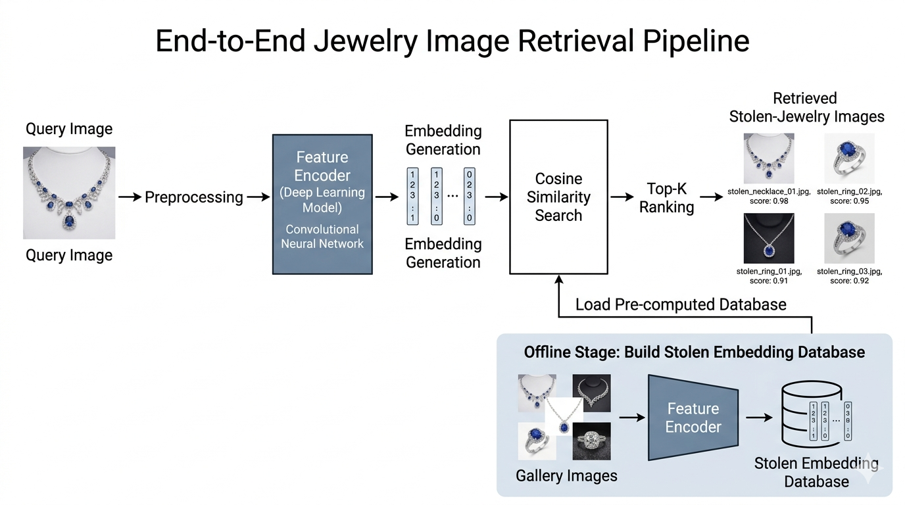

# Retrieval-First Jewellery Image Matching

## Site map

| Section on this page | Jump |
|---|---|
| [Project Summary](#project-summary) | Overview of the project |
| [Reading order](#reading-order-portfolio) | Numbered portfolio sections |
| [Team Members](#team-members) | Roles  |
| [Contribution Matrix](#contribution-matrix) | Link to matrix |
| [Hosted deliverables](#hosted-deliverables-and-prototype-links) | Code, report, links |
| [Portfolio Contents](#portfolio-contents) | All portfolio sections (table) |
| [System Overview](#system-overview) | Flowchart image |
| [Repository Structure](#repository-structure) | Folder layout |
| [GitHub and SSH](#github-repository-private-ssh) | Remote URL and SSH setup |
| [Notes](#notes) | Version control and evidence |

## Project Summary

This interdisciplinary project addresses **content-based retrieval** of **jewellery images**: a **query image** is ranked against a **gallery** of **stolen-jewellery** images under **strict train / validation / test** governance, with the **gallery excluded** from supervised parameter updates. **Convolutional** baselines (**ResNet18**, **VGG16**, **EfficientNet-B0**, including a **two-phase ResNet18** variant) are compared with **OpenCLIP** encoders; the **final OpenCLIP ViT-L/14** configuration attains the strongest headline metrics on the common protocol. A concise summary of **evaluation outcomes** appears in [Section 5 — Results and evaluation](pages/05_results_and_evaluation.md); the **full thesis-style narrative** is given in the [technical report](documents/README_DETAILED_REPORT.md#table-of-contents).

## Reading order (portfolio)

Read the portfolio **in numerical order** for a logical progression from **motivation** through **methods**, **implementation**, **results**, **management**, **governance**, and **conclusion**:

1. [Overview](pages/01_overview.md)  
2. [Literature](pages/02_literature.md)  
3. [Methodology](pages/03_methodology.md)  
4. [Implementation](pages/04_implementation.md)  
5. [Results and evaluation](pages/05_results_and_evaluation.md)  
6. [Management](pages/06_management.md)  
7. [Meetings and review cycles](pages/07_meetings_and_review_cycles.md)  
8. [Peer review and feedback](pages/08_feedback.md)  
9. [Contributions](pages/09_contributions.md)  
10. [Conclusion](pages/10_conclusion.md)  
11. [Submission checklist](pages/11_checklist.md)

**Hub with duplicate links:** [`pages/README.md`](pages/README.md).

## Team Members

| Name      | Role / Main Contribution |
|-----------|-------------------------|
| David | Project coordination, literature synthesis, report structuring and integration |
| George | Data collection, dataset structuring, and preprocessing pipeline |
| Ananna  | CNN models (ResNet18, VGG16, EfficientNet-B0), model training, and retrieval evaluation (joint responsibility with Abdi) |
| Abdi  | OpenCLIP models (ViT-B/32, ViT-L/14), transformer pipeline, retrieval evaluation, and result interpretation (joint responsibility with Ananna) |
| Laknath  | Discussion, ethics and limitations framing, future work, and portfolio preparation |


## Contribution Matrix


| Task / Output | David (20%) | George (15%) | Ananna (30%) | Abdi (20%) | Laknath (15%) |
|---|---|---|---|---|---|
| Literature synthesis | Lead | Co | Co | Co | Co |
| Project management | Lead | Co | Co | Co | Co |
| Experimental design (splits, preprocessing) | Co | Lead | Co | Co | Co |
| Implementation (`code/01–06`) | Co | Co | Lead | Lead | Co |
| Testing and evaluation | Co | Co | Lead | Lead | Co |
| Documentation and portfolio | Co | Co | Lead | Co | Lead |

## Hosted deliverables and prototype links

| Deliverable | Link | Notes |
|---|---|---|
| Portfolio (this page) | [README.md](README.md) | Entry point; use site map above |
| Numbered portfolio sections | [`pages/README.md`](pages/README.md) | Table of contents |
| Source code | [`code/README.md`](code/README.md) | Run instructions |
| Technical report | [`documents/README_DETAILED_REPORT.md`](documents/README_DETAILED_REPORT.md#table-of-contents) | In-document table of contents |
| Documents index | [`documents/README.md`](documents/README.md) | Lists `documents/` files |
| GitHub (private, SSH) | `git@github.com:Fahmida10/Jwellery_retrieval.git` | Clone and push with SSH (see below) |

## GitHub repository (private, SSH)

**Remote (SSH).** Use this URL with Git over SSH:

`git@github.com:Fahmida10/Jwellery_retrieval.git`

**HTTPS (optional).** `https://github.com/Fahmida10/Jwellery_retrieval.git` (GitHub login or personal access token when prompted).

### One-time SSH setup on your computer

1. **Create a key** (PowerShell or Git Bash):  
   `ssh-keygen -t ed25519 -C "your_email@example.com"`  
   Accept the default path (`%USERPROFILE%\.ssh\id_ed25519`) unless you already use another key.

2. **Start the SSH agent and register the key** (PowerShell as Administrator, once):  
   `Get-Service ssh-agent | Set-Service -StartupType Manual`  
   `Start-Service ssh-agent`  
   `ssh-add $env:USERPROFILE\.ssh\id_ed25519`

3. **Copy the public key** (the `.pub` file — never share the private key without `.pub`):  
   `Get-Content $env:USERPROFILE\.ssh\id_ed25519.pub`  
   Copy the whole line.

4. **Add the key in GitHub:** GitHub → your **profile photo** → **Settings** → **SSH and GPG keys** → **New SSH key** → paste the public key → save.

5. **Test:**  
   `ssh -T git@github.com`  
   You should see a message that you have authenticated (username may be shown).

### Push this project from the command line (first time)

From the repository root (this folder), after SSH works:

```text
git init
git remote add origin git@github.com:Fahmida10/Jwellery_retrieval.git
git branch -M main
git add .
git commit -m "Initial commit: jewellery retrieval and portfolio"
git push -u origin main
```

If `origin` already exists: `git remote remove origin`, then `git remote add origin ...` again.

**Collaborators (private repo):** on GitHub open the repository → **Settings** → **Collaborators** → add people by GitHub username or invite by email. They use their **own** SSH keys on their machines.

**Codespaces:** GitHub → repository → **Code** → **Codespaces** → create a codespace; it uses GitHub-hosted dev containers (separate from local SSH, but still uses your GitHub identity).

## Portfolio Contents

| § | Section | Description |
|---:|---|---|
| 1 | [Overview](pages/01_overview.md) | Aim, background, users, scope |
| 2 | [Literature](pages/02_literature.md) | Annotated sources; link to full bibliography |
| 3 | [Methodology](pages/03_methodology.md) | Approach, tools, workflow, design, risks |
| 4 | [Implementation](pages/04_implementation.md) | Architecture, code layout, evidence, provenance |
| 5 | [Results and evaluation](pages/05_results_and_evaluation.md) | **Quantitative results**, protocol, limitations |
| 6 | [Management](pages/06_management.md) | Timeline structure, tools, risk register |
| 7 | [Meetings and review cycles](pages/07_meetings_and_review_cycles.md) | Meeting record and cyclical retrospective |
| 8 | [Peer review and feedback](pages/08_feedback.md) | Internal review; slot for tutor feedback |
| 9 | [Contributions](pages/09_contributions.md) | Contribution matrix |
| 10 | [Conclusion](pages/10_conclusion.md) | Synthesis and future work pointers |
| 11 | [Checklist](pages/11_checklist.md) | Pre-submission verification |

## System Overview



Additional figures: [`images/architecture_diagram.png`](images/architecture_diagram.png), [`images/unified_retrieval_pipeline.png`](images/unified_retrieval_pipeline.png). Index: [`images/README.md`](images/README.md).

## Repository Structure

- [`pages/`](pages/) — numbered portfolio (Sections 1–11); start at [`pages/README.md`](pages/README.md).
- [`images/`](images/) — figures; see [`images/README.md`](images/README.md).
- [`documents/`](documents/) — technical report and notes; see [`documents/README.md`](documents/README.md).
- [`code/`](code/) — source code; see [`code/README.md`](code/README.md).

A **Gantt chart** summarizing the project timeline is provided [here](11_GanttChart.md).

## Notes

This portfolio is written in **Markdown** and is intended to be version-controlled (**GitHub** or **GitLab**). **Commit history** documents development over time.
