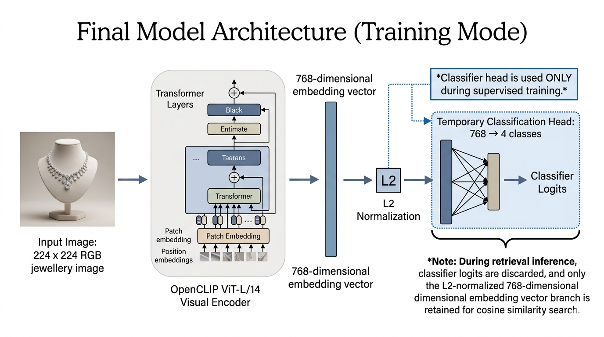
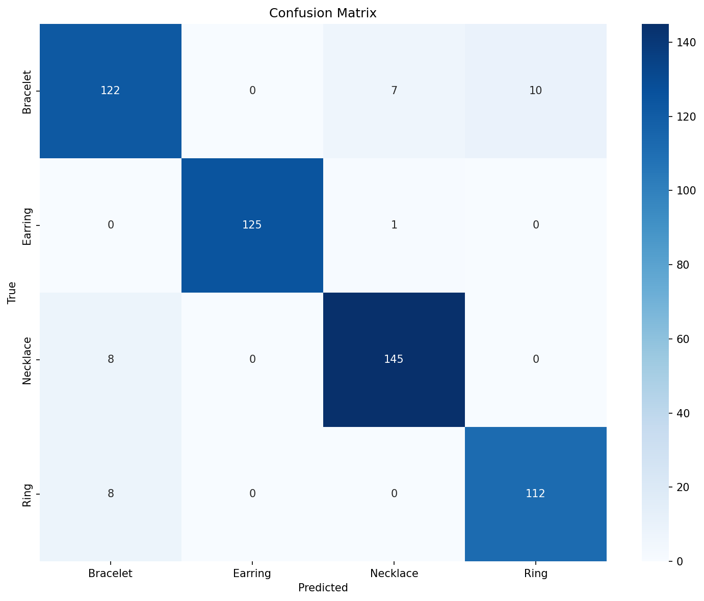
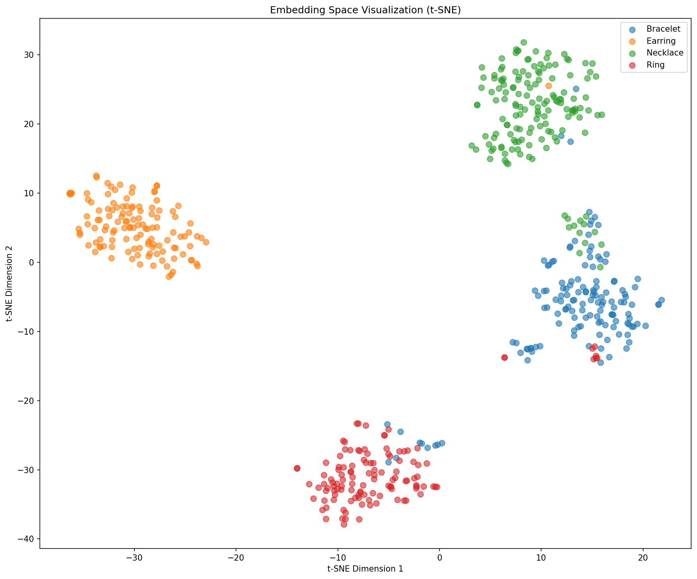

# Jewelry Retrieval Model Code

This GitLab package contains only the code folders for the six jewelry retrieval models. Each model folder is self-contained: code, configuration, training/evaluation scripts, architecture figure, result figures, and a model-specific README.

There is no separate report folder and no separate evaluation folder in this upload package. The figures needed for documentation are kept inside the relevant model folder under `figures/`.

## Final Model Summary

| Final model | mAP | Embedding accuracy | Val -> Test R@1 | Val -> Test R@5 | Val -> Test R@20 |
|---|---:|---:|---:|---:|---:|
| OpenCLIP ViT-L/14 retrieval model | 0.9235 | 0.9368 | 0.9442 | 0.9854 | 0.9927 |

## Final Model Evidence

| Architecture | Confusion matrix |
|---|---|
|  |  |

| t-SNE embedding space | Retrieval result |
|---|---|
|  |  |

## Model Folders

| Stage | Folder | Model | Key result |
|---|---|---|---|
| 01 | `01_resnet18` | ResNet18 baseline | mAP 0.6860, embedding accuracy 0.8086 |
| 02 | `02_vgg16` | VGG16 baseline | mAP 0.6817, embedding accuracy 0.8810 |
| 03 | `03_efficientnet_b0` | EfficientNet-B0 | mAP 0.8966, embedding accuracy 0.9257 |
| 04 | `04_resnet18_2phase` | ResNet18 two-phase | mAP 0.6617, embedding accuracy 0.9033 |
| 05 | `05_clip_b32` | OpenCLIP ViT-B/32 | mAP 0.3267, embedding accuracy 0.4015 |
| 06 | `06_clip_l14` | OpenCLIP ViT-L/14 retrieval | mAP 0.9235, embedding accuracy 0.9368 |

## Folder Layout

```text
jewelry_retrieval_gitlab_upload/
├── 01_resnet18/
│   ├── figures/
│   ├── README.md
│   ├── config.py
│   ├── dataset.py
│   ├── model.py
│   ├── train.py
│   ├── extract_embeddings.py
│   └── evaluate.py
├── 02_vgg16/
├── 03_efficientnet_b0/
├── 04_resnet18_2phase/
├── 05_clip_b32/
├── 06_clip_l14/
├── shared_retrieval_pipeline.py
├── SUBMISSION_NOTES.md
└── README.md
```

Each model README contains:

- model architecture
- architecture diagram
- training configuration
- measured results
- confusion matrix
- t-SNE embedding visualization
- run commands

## Dataset Layout

Each model expects this dataset structure:

```text
Jewellery Dataset Clean_copy/
├── stolen/
├── Train/
│   ├── Bracelet/
│   ├── Earring/
│   ├── Necklace/
│   └── Ring/
├── Validation/
│   ├── Bracelet/
│   ├── Earring/
│   ├── Necklace/
│   └── Ring/
└── Test/
    ├── Bracelet/
    ├── Earring/
    ├── Necklace/
    └── Ring/
```

Update `DATASET_ROOT` in each model's `config.py` if the dataset is stored somewhere else.

## Install Dependencies

```bash
python3 -m venv venv
source venv/bin/activate
pip install -r 06_clip_l14/requirements.txt
```

## Run A Model

Example:

```bash
cd 03_efficientnet_b0
python train.py
python extract_embeddings.py
python evaluate.py
```

Final model:

```bash
python 06_clip_l14/train.py
python 06_clip_l14/extract_embeddings.py
python 06_clip_l14/evaluate.py
python 06_clip_l14/inference.py --query /path/to/query.jpg --top_k 10 --visualize
```

## Upload Policy

The repository excludes generated heavy files:

- `*.pkl`, `*.pickle`
- `*.pth`, `*.pt`, `*.ckpt`
- `checkpoints/`
- `embeddings/`
- `venv/`, `.venv/`
- `__pycache__/`

Only model code, model README files, and lightweight documentation figures are included.
