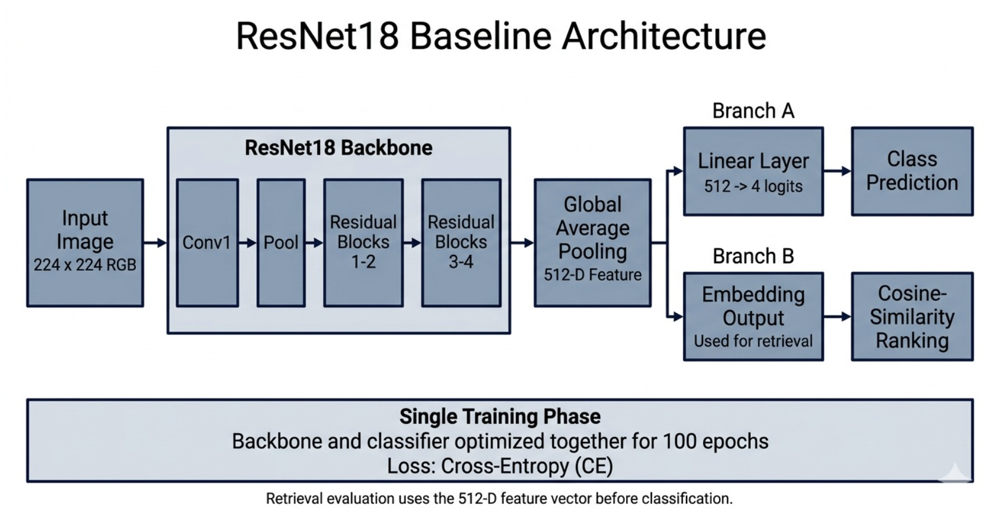
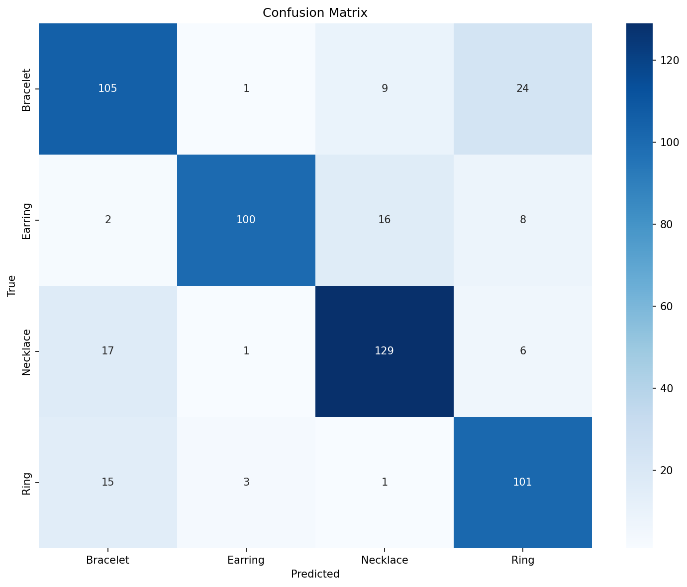
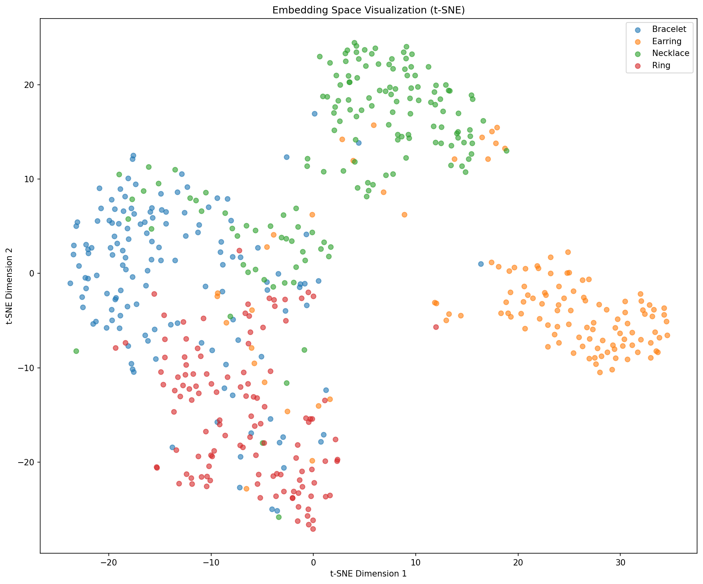

# Stage 01: ResNet18 Baseline

This stage establishes the first reference point for the jewelry retrieval study. It uses an ImageNet-pretrained ResNet18 backbone with a linear classifier and a single-phase cross-entropy training configuration. The purpose is to provide a clear ResNet18 baseline before stronger CNN and OpenCLIP models are introduced.

## Model Architecture



| Component | Configuration |
|---|---|
| Backbone | ResNet18 pretrained on ImageNet |
| Input resolution | 224 x 224 RGB |
| Feature extractor | ResNet18 convolutional trunk without final fully connected layer |
| Embedding vector | 512-D pre-classifier feature vector |
| Classifier | Linear layer, 512 -> 4 jewelry classes |
| Retrieval feature | Output of `get_embeddings()` before the classifier |
| Normalization | ImageNet mean and standard deviation |

Architecture flow:

```text
Image -> ResNet18 convolutional backbone -> global pooled 512-D feature -> linear classifier -> class logits
```

The architecture uses the standard ResNet18 feature representation directly, without an additional projection head or multi-phase fine-tuning schedule.

## Training Setup

| Setting | Value |
|---|---:|
| Epoch budget | 100 |
| Optimizer | SGD with momentum |
| Learning rate | 0.1 |
| Batch size | 32 |
| Weight decay | 0 |
| Augmentation | Disabled |
| Mixed precision | Disabled |
| Loss | Cross-entropy |

This configuration provides a controlled baseline using the same 100-epoch budget as the later models.

## Results

Results are included below. Visual artifacts for this stage are stored in the portfolio folder `images/` (see filenames prefixed with `stage01_resnet18_`).

| Metric | Value |
|---|---:|
| Test set size | 538 |
| Embedding dimension | 512 |
| mAP | 0.6860 |
| Nearest-centroid classification accuracy | 0.8086 |
| Val -> Test Recall@1 | 0.8135 |
| Val -> Test Recall@5 | 0.9452 |
| Val -> Test Recall@10 | 0.9717 |
| Val -> Test Recall@20 | 0.9817 |

Class-level behavior:

| Class | Precision | Recall | F1-score | Support |
|---|---:|---:|---:|---:|
| Bracelet | 0.76 | 0.76 | 0.76 | 139 |
| Earring | 0.95 | 0.79 | 0.87 | 126 |
| Necklace | 0.83 | 0.84 | 0.84 | 153 |
| Ring | 0.73 | 0.84 | 0.78 | 120 |

## Visual Evidence

| Confusion matrix | t-SNE embedding space |
|---|---|
|  |  |

## How To Run

```bash
cd code/01_resnet18
python train.py
python extract_embeddings.py
python evaluate.py
```

Generated checkpoints, embeddings, and pickle files are excluded from the GitLab upload.
