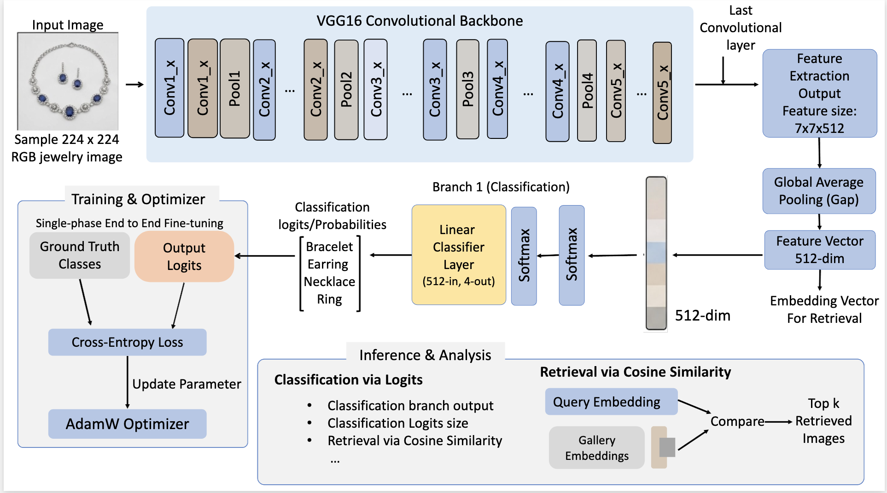
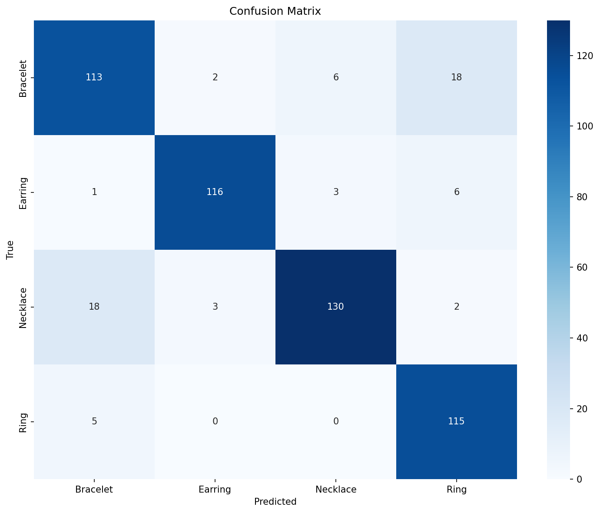
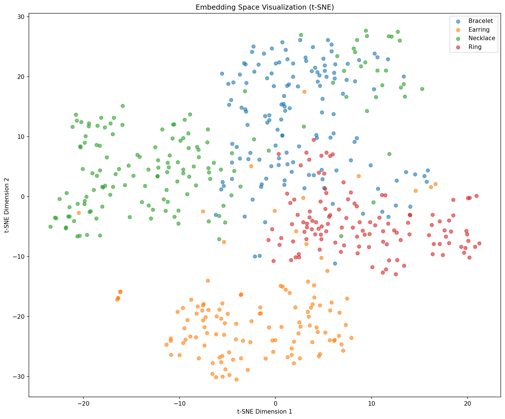

# Stage 02: VGG16 Baseline

This stage introduces a stronger classical CNN baseline using VGG16 pretrained on ImageNet. It keeps the training recipe simple and single-phase, which makes the impact of backbone capacity easy to compare against Stage 01.

## Model Architecture



| Component | Configuration |
|---|---|
| Backbone | VGG16 pretrained on ImageNet |
| Input resolution | 224 x 224 RGB |
| Feature extractor | VGG16 convolutional feature stack |
| Pooling | Adaptive average pooling to 7 x 7 |
| Embedding vector | 25,088-D flattened feature vector |
| Classifier | Linear layer, 25,088 -> 4 jewelry classes |
| Retrieval feature | Flattened pooled feature before the classifier |

Architecture flow:

```text
Image -> VGG16 feature stack -> adaptive 7x7 pooling -> 25,088-D feature -> linear classifier
```

VGG16 is heavier than ResNet18 but provides a straightforward high-capacity CNN reference.

## Training Setup

| Setting | Value |
|---|---:|
| Epoch budget | 100 |
| Optimizer | AdamW |
| Learning rate | 1e-4 |
| Batch size | 32 |
| Weight decay | 1e-4 |
| Augmentation | Enabled |
| Mixed precision | Enabled |
| Loss | Cross-entropy |
| Scheduler | Cosine annealing |

## Results

Results are included below. Stage visuals are in `images/` (`stage02_vgg16_*`).

| Metric | Value |
|---|---:|
| Test set size | 538 |
| Embedding dimension | 25,088 |
| mAP | 0.6817 |
| Nearest-centroid classification accuracy | 0.8810 |
| Val -> Test Recall@1 | 0.8647 |
| Val -> Test Recall@5 | 0.9570 |
| Val -> Test Recall@10 | 0.9799 |
| Val -> Test Recall@20 | 0.9890 |

Class-level behavior:

| Class | Precision | Recall | F1-score | Support |
|---|---:|---:|---:|---:|
| Bracelet | 0.82 | 0.81 | 0.82 | 139 |
| Earring | 0.96 | 0.92 | 0.94 | 126 |
| Necklace | 0.94 | 0.85 | 0.89 | 153 |
| Ring | 0.82 | 0.96 | 0.88 | 120 |

## Visual Evidence

| Confusion matrix | t-SNE embedding space |
|---|---|
|  |  |

## How To Run

```bash
cd code/02_vgg16
python train.py
python extract_embeddings.py
python evaluate.py
```

Generated checkpoints, embeddings, and pickle files are excluded from the GitLab upload.
