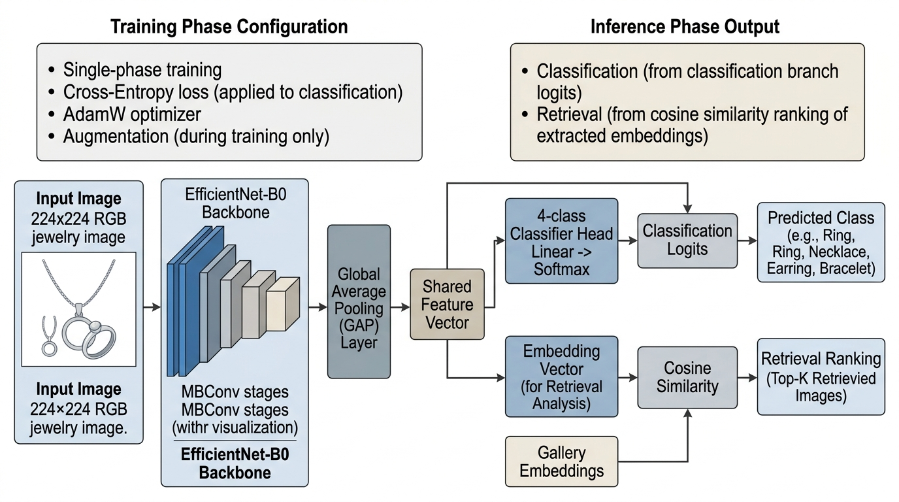
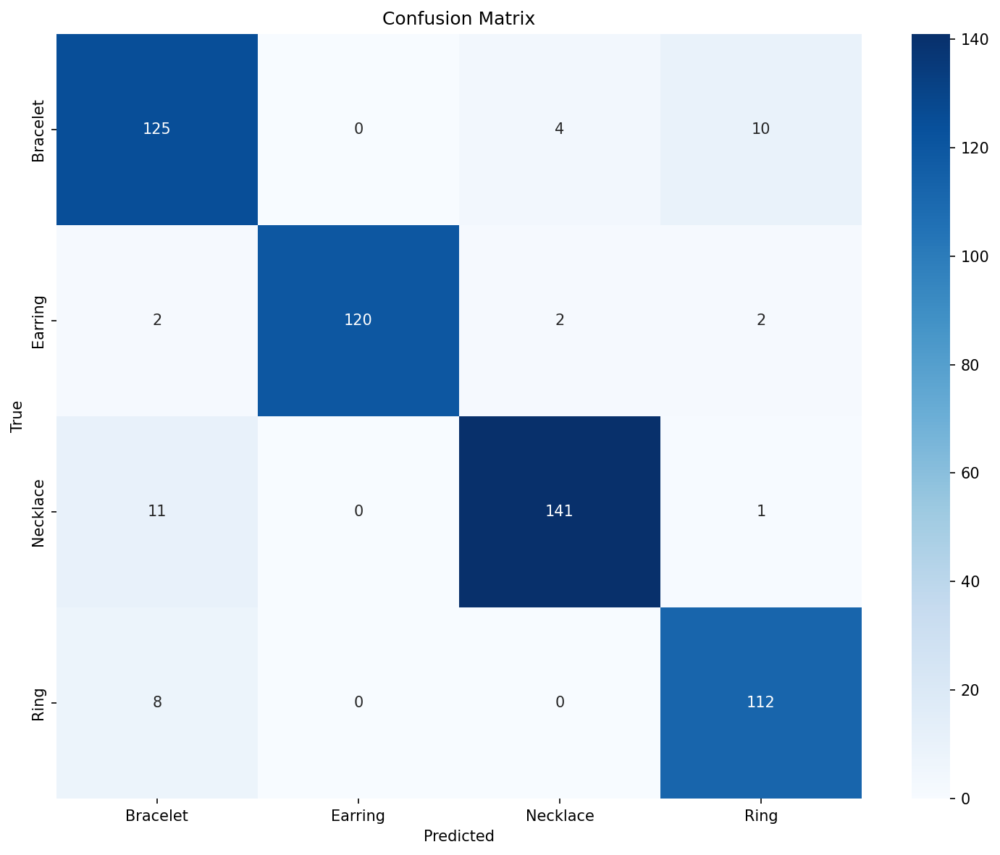
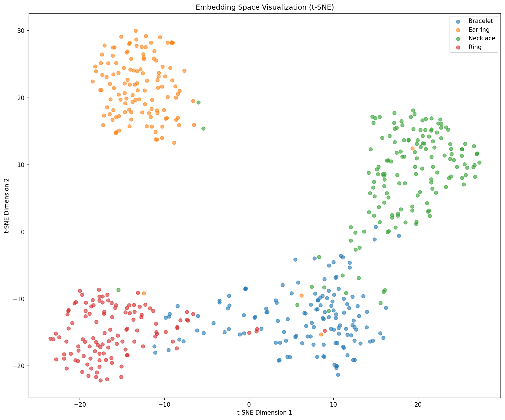

# Stage 03: EfficientNet-B0

This stage replaces the VGG16 baseline with EfficientNet-B0, a more parameter-efficient CNN backbone. The training protocol remains single-phase so that the comparison focuses on the effect of architecture.

## Model Architecture



| Component | Configuration |
|---|---|
| Backbone | EfficientNet-B0 pretrained on ImageNet |
| Input resolution | 224 x 224 RGB |
| Feature extractor | EfficientNet-B0 feature blocks |
| Pooling | Global adaptive average pooling |
| Embedding vector | 1,280-D feature vector |
| Classifier | Linear layer, 1,280 -> 4 jewelry classes |
| Retrieval feature | Pooled feature before the classifier |

Architecture flow:

```text
Image -> EfficientNet-B0 feature blocks -> global pooling -> 1,280-D feature -> linear classifier
```

EfficientNet-B0 provides a strong CNN balance between representational power and compact feature dimensionality.

## Training Setup

| Setting | Value |
|---|---:|
| Epoch budget | 100 |
| Optimizer | AdamW |
| Learning rate | 1e-4 |
| Batch size | 32 |
| Weight decay | 1e-4 |
| Augmentation | Enabled |
| Mixed precision | Enabled |
| Loss | Cross-entropy |
| Scheduler | Cosine annealing |

## Results

Results are included below. Stage visuals are in `images/` (`stage03_efficientnet_b0_*`).

| Metric | Value |
|---|---:|
| Test set size | 538 |
| Embedding dimension | 1,280 |
| mAP | 0.8966 |
| Nearest-centroid classification accuracy | 0.9257 |
| Val -> Test Recall@1 | 0.9223 |
| Val -> Test Recall@5 | 0.9753 |
| Val -> Test Recall@10 | 0.9845 |
| Val -> Test Recall@20 | 0.9899 |

Class-level behavior:

| Class | Precision | Recall | F1-score | Support |
|---|---:|---:|---:|---:|
| Bracelet | 0.86 | 0.90 | 0.88 | 139 |
| Earring | 1.00 | 0.95 | 0.98 | 126 |
| Necklace | 0.96 | 0.92 | 0.94 | 153 |
| Ring | 0.90 | 0.93 | 0.91 | 120 |

## Visual Evidence

| Confusion matrix | t-SNE embedding space |
|---|---|
|  |  |

## How To Run

```bash
cd code/03_efficientnet_b0
python train.py
python extract_embeddings.py
python evaluate.py
```

Generated checkpoints, embeddings, and pickle files are excluded from the GitLab upload.
