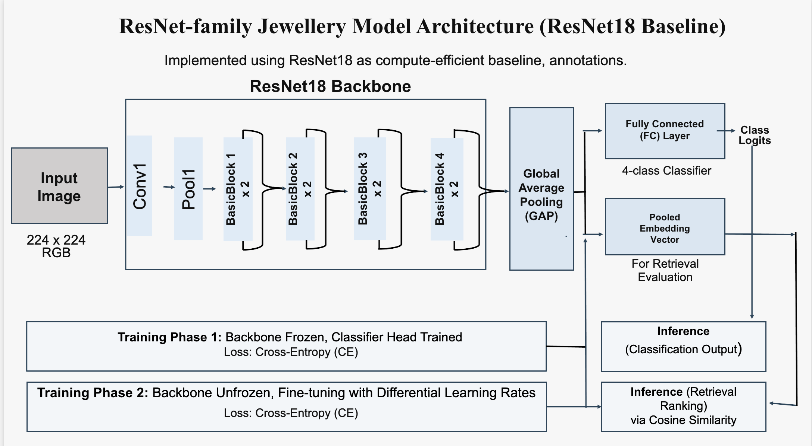
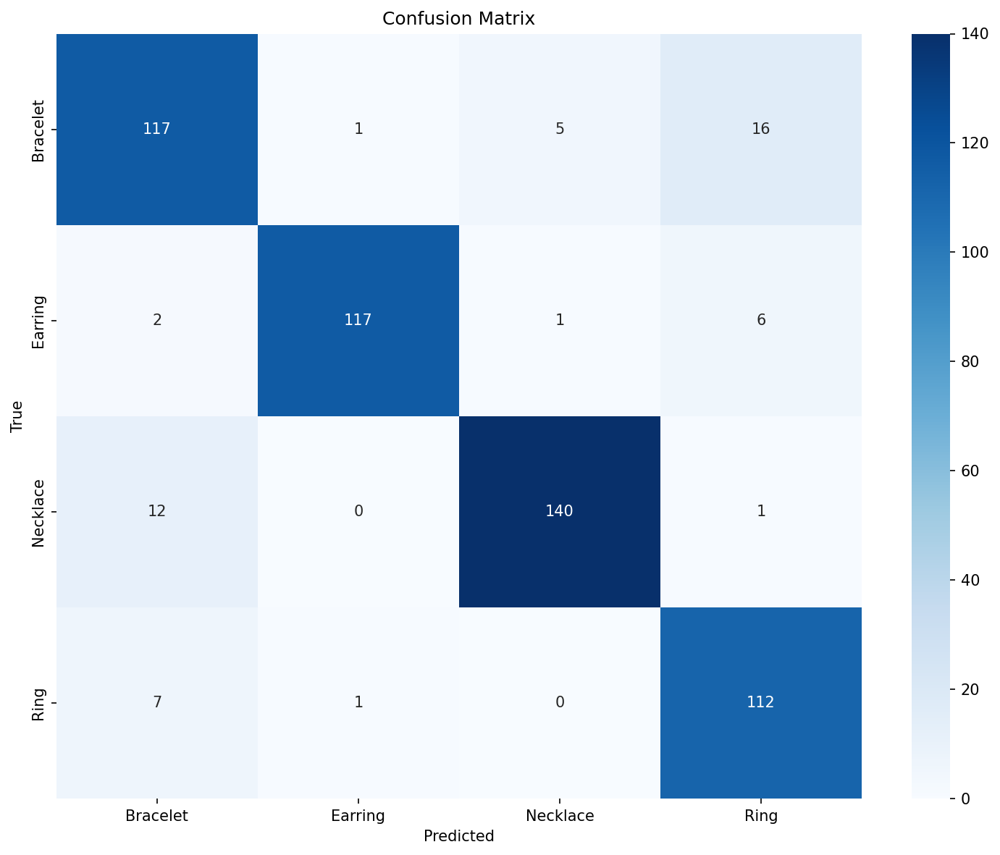
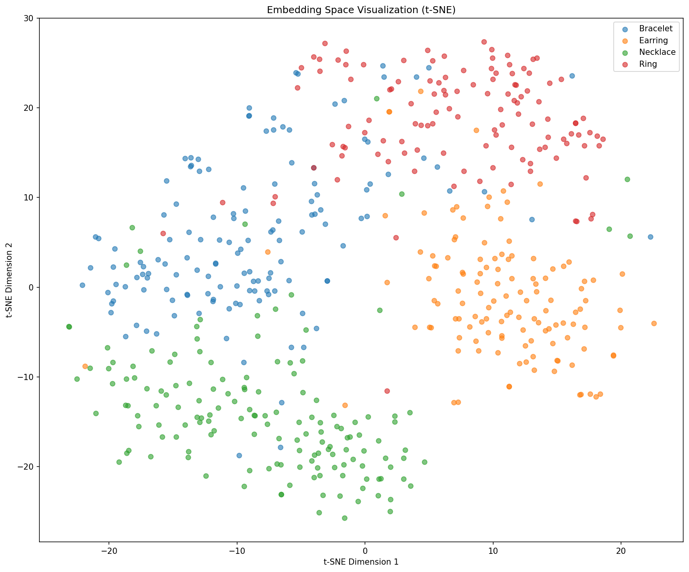

# Stage 04: ResNet18 Two-Phase Fine-Tuning

This stage keeps the ResNet18 backbone but changes the training strategy. Instead of training all parameters from the beginning, it first adapts the classifier head and then fine-tunes the backbone with a smaller learning rate. This isolates the effect of a more stable transfer-learning schedule.

## Model Architecture



| Component | Configuration |
|---|---|
| Backbone | ResNet18 pretrained on ImageNet |
| Input resolution | 224 x 224 RGB |
| Feature extractor | ResNet18 convolutional trunk without final fully connected layer |
| Embedding vector | 512-D pre-classifier feature vector |
| Classifier | Linear layer, 512 -> 4 jewelry classes |
| Retrieval feature | Output of `get_embeddings()` before the classifier |

Architecture flow:

```text
Image -> ResNet18 convolutional backbone -> global pooled 512-D feature -> linear classifier
```

This stage keeps the Stage 01 backbone so the comparison focuses on the training schedule.

## Training Setup

| Phase | Epochs | Trainable parameters | Learning rate |
|---|---:|---|---:|
| Phase 1 | 30 | Classifier head only | 1e-3 |
| Phase 2 | 70 | Backbone + classifier head | Backbone 1e-5, head 1e-4 |

Shared settings:

| Setting | Value |
|---|---:|
| Total epoch budget | 100 |
| Optimizer | AdamW |
| Batch size | 32 |
| Weight decay | 1e-4 |
| Augmentation | Enabled |
| Mixed precision | Enabled |
| Loss | Cross-entropy |
| Scheduler | Cosine annealing |

## Results

Results are included below. Stage visuals are in `images/` (`stage04_resnet18_2phase_*`).

| Metric | Value |
|---|---:|
| Test set size | 538 |
| Embedding dimension | 512 |
| mAP | 0.6617 |
| Nearest-centroid classification accuracy | 0.9033 |
| Val -> Test Recall@1 | 0.8583 |
| Val -> Test Recall@5 | 0.9790 |
| Val -> Test Recall@10 | 0.9945 |
| Val -> Test Recall@20 | 0.9973 |

Class-level behavior:

| Class | Precision | Recall | F1-score | Support |
|---|---:|---:|---:|---:|
| Bracelet | 0.85 | 0.84 | 0.84 | 139 |
| Earring | 0.98 | 0.93 | 0.96 | 126 |
| Necklace | 0.96 | 0.92 | 0.94 | 153 |
| Ring | 0.83 | 0.93 | 0.88 | 120 |

## Visual Evidence

| Confusion matrix | t-SNE embedding space |
|---|---|
|  |  |

## How To Run

```bash
cd code/04_resnet18_2phase
python train.py
python extract_embeddings.py
python evaluate.py
```

Generated checkpoints, embeddings, and pickle files are excluded from the GitLab upload.
