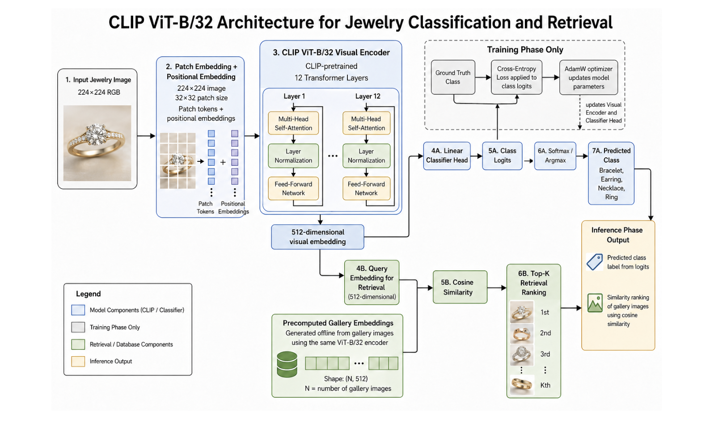
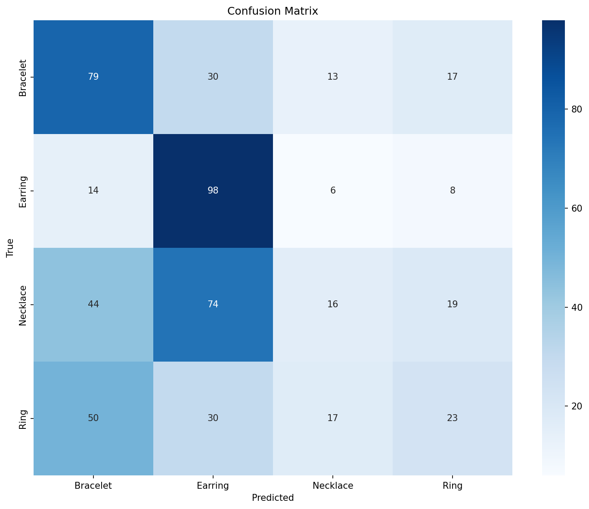
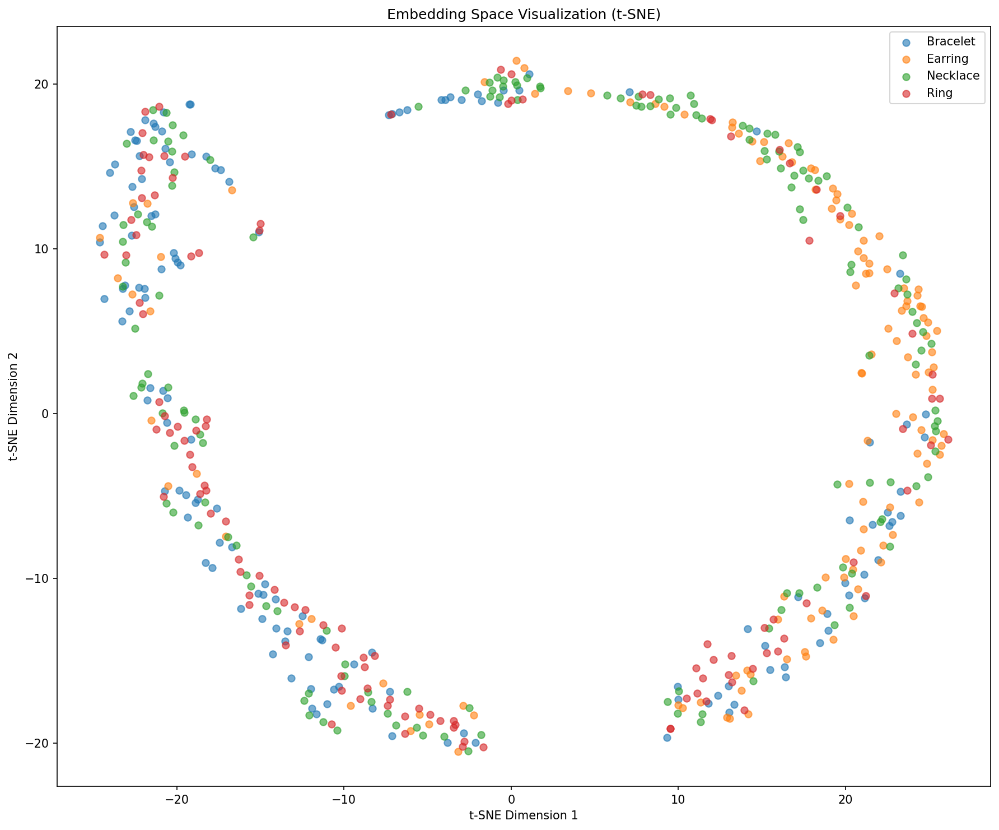

# Stage 05: OpenCLIP ViT-B/32 Baseline

This stage moves from CNNs to a transformer backbone. It uses OpenCLIP ViT-B/32 with a lightweight classification head and a single-phase cross-entropy training loop. It serves as the compact CLIP baseline before the final Stage 06 model.

## Model Architecture



| Component | Configuration |
|---|---|
| Backbone | OpenCLIP ViT-B/32 visual encoder |
| Pretraining | OpenAI CLIP weights |
| Input resolution | 224 x 224 RGB |
| Embedding vector | 512-D L2-normalized image embedding |
| Projection head | Identity when backbone output already matches 512-D |
| Classifier | Linear layer, 512 -> 4 jewelry classes |
| Retrieval feature | Normalized CLIP image embedding |
| Similarity basis | Cosine similarity over normalized embeddings |

Architecture flow:

```text
Image -> OpenCLIP ViT-B/32 visual encoder -> 512-D normalized embedding -> linear classifier
```

This stage tests whether a compact CLIP visual representation is useful before adding the final multi-phase retrieval objective.

## Training Setup

| Setting | Value |
|---|---:|
| Epoch budget | 100 |
| Optimizer | AdamW |
| Learning rate | 1e-4 |
| Batch size | 32 |
| Weight decay | 1e-4 |
| Augmentation | Enabled |
| Mixed precision | Enabled |
| Loss | Cross-entropy |
| Scheduler | Cosine annealing |

## Results

Results are included below. Stage visuals are in `images/` (`stage05_clip_b32_*`).

| Metric | Value |
|---|---:|
| Test set size | 538 |
| Embedding dimension | 512 |
| mAP | 0.3267 |
| Nearest-centroid classification accuracy | 0.4015 |
| Val -> Test Recall@1 | 0.3455 |
| Val -> Test Recall@5 | 0.7952 |
| Val -> Test Recall@10 | 0.9442 |
| Val -> Test Recall@20 | 0.9890 |

Class-level behavior:

| Class | Precision | Recall | F1-score | Support |
|---|---:|---:|---:|---:|
| Bracelet | 0.42 | 0.57 | 0.48 | 139 |
| Earring | 0.42 | 0.78 | 0.55 | 126 |
| Necklace | 0.31 | 0.10 | 0.16 | 153 |
| Ring | 0.34 | 0.19 | 0.25 | 120 |

## Visual Evidence

| Confusion matrix | t-SNE embedding space |
|---|---|
|  |  |

## How To Run

```bash
cd code/05_clip_b32
pip install -r requirements.txt
python train.py
python extract_embeddings.py
python evaluate.py
```

Generated checkpoints, embeddings, and pickle files are excluded from the GitLab upload.
