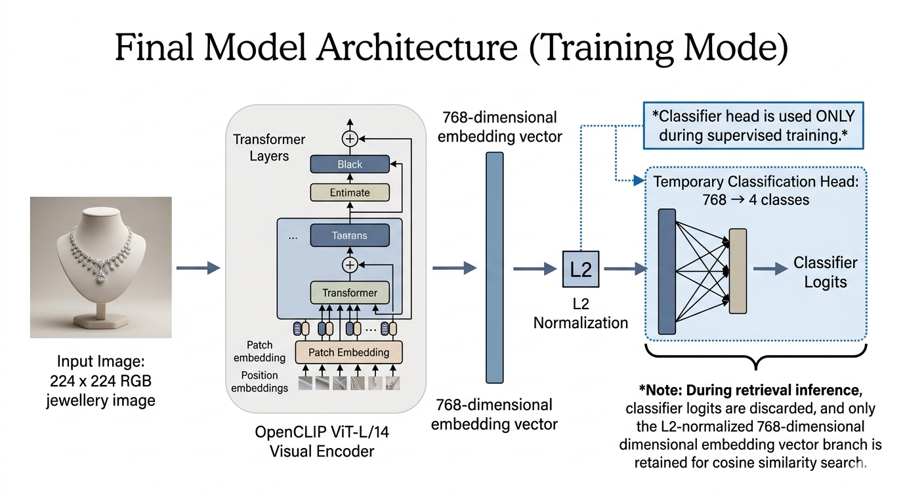
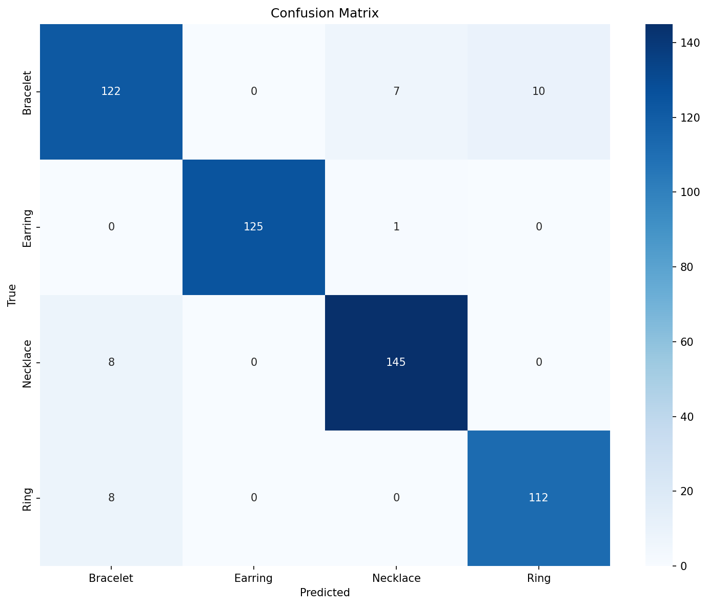
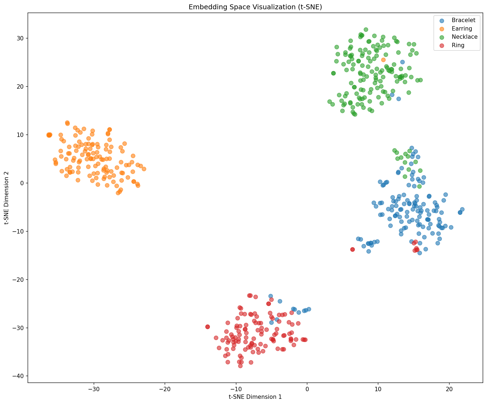

# Stage 06: Final OpenCLIP ViT-L/14 Retrieval Model

This is the final model in the project. It uses OpenCLIP ViT-L/14 as a retrieval backbone, trains with a three-phase curriculum, and evaluates the learned embedding space with cosine-similarity retrieval.

## Model Architecture



| Component | Configuration |
|---|---|
| Backbone | OpenCLIP ViT-L/14 visual encoder |
| Pretraining | OpenAI CLIP weights with QuickGELU compatibility |
| Input resolution | 224 x 224 RGB |
| Embedding vector | 768-D L2-normalized image embedding |
| Projection head | Identity when output dimension is already 768-D |
| Training head | Linear classifier, 768 -> 4 jewelry classes |
| Retrieval feature | Normalized embedding from the visual encoder |
| Similarity metric | Cosine similarity |

Architecture flow:

```text
Image -> OpenCLIP ViT-L/14 visual encoder -> 768-D normalized embedding -> Top-K cosine retrieval
                                                        |
                                                        +-> classifier head during training
```

The classifier head is used to guide supervised training. Retrieval is performed with the normalized image embeddings.

## Training Curriculum

The submitted configuration uses a 100-epoch total budget. Phase transitions were triggered by training accuracy thresholds or maximum epoch limits, while the final checkpoint was selected using validation loss.

| Phase | Maximum epochs | Trainable parameters | Objective |
|---|---:|---|---|
| Phase 1 | 10 | Classifier head only | Cross-entropy |
| Phase 2 | 30 | Backbone + classifier head | Cross-entropy |
| Phase 3 | Remaining budget | Backbone + classifier head | Supervised contrastive + cross-entropy |

Additional settings:

| Setting | Value |
|---|---:|
| Optimizer | AdamW |
| Initial learning rate | 1e-4 |
| Batch size | 32 |
| Weight decay | 1e-4 |
| Temperature | 0.07 |
| Augmentation | Enabled |
| Mixed precision | Enabled |
| Top-K default | 10 |

## Results

Results are included below. Stage visuals are in `images/` (`stage06_clip_l14_*`).

| Metric | Value |
|---|---:|
| Test set size | 538 |
| Embedding dimension | 768 |
| Test -> Test Recall@1 | 1.0000 |
| Test -> Test Recall@5 | 1.0000 |
| Test -> Test Recall@10 | 1.0000 |
| Test -> Test Recall@20 | 1.0000 |
| mAP | 0.9235 |
| Nearest-centroid classification accuracy | 0.9368 |
| Val -> Test Recall@1 | 0.9442 |
| Val -> Test Recall@5 | 0.9854 |
| Val -> Test Recall@10 | 0.9890 |
| Val -> Test Recall@20 | 0.9927 |

The stricter Val -> Test retrieval protocol is the main generalization check because query and gallery images come from different splits.

## Visual Evidence

| Confusion matrix | t-SNE embedding space |
|---|---|
|  |  |

| Retrieval proof | Retrieval result |
|---|---|
|  |  |

## How To Run

From the project root:

```bash
pip install -r code/06_clip_l14/requirements.txt
python code/06_clip_l14/train.py
python code/06_clip_l14/extract_embeddings.py
python code/06_clip_l14/evaluate.py
python code/06_clip_l14/inference.py --query /path/to/query.jpg --top_k 10 --visualize
```

Generated checkpoints, embeddings, and pickle files are excluded from the GitLab upload.
