# Retrieval-First Jewellery Image Matching Using CNN Baselines and OpenCLIP

## Table of contents

- [Abstract](#abstract)
- [Introduction](#introduction)
- [Related Work](#related-work)
- [Dataset Description](#dataset-description)
- [Methodology](#methodology)
- [Results](#results)
- [Discussion](#discussion)
- [Ethical Considerations](#ethical-considerations)
- [Limitations](#limitations)
- [Conclusion](#conclusion)
- [Future Work](#future-work)
- [References](#references)
- [Portfolio home (repository README)](../README.md)

## Abstract

This report presents a retrieval-first jewellery image matching framework in which a query image is used to return Top-K similar items from a stolen-jewellery gallery. The problem is challenging because many items share coarse category appearance but differ in subtle design cues, while viewpoint and illumination variations increase ambiguity. To address this, the study evaluates representative CNN baselines (VGG16, ResNet18, EfficientNet-B0) and OpenCLIP variants under a unified protocol with strict split governance and leakage control. The final method, based on OpenCLIP ViT-L/14 with multi-phase retrieval-aware optimization, achieves the best overall performance: mAP = 0.9235, nearest-centroid embedding accuracy = 0.9368, and strong cross-dataset retrieval (R@1 = 0.9442, R@5 = 0.9854, R@10 = 0.9890, R@20 = 0.9927). The strongest CNN baseline (EfficientNet-B0) remains competitive (mAP = 0.8966) but is consistently outperformed by the final transformer-based retrieval model. In addition to quantitative gains, the system provides auditable Top-K outputs with filename-level traceability and practical latency for small galleries after offline indexing. These results support a reproducible and interpretable retrieval pipeline for jewellery matching under limited-data conditions.

**Index Terms:** Jewellery Retrieval, Image Retrieval, OpenCLIP, Vision Transformer, Metric Learning, Computer Vision.

## Introduction

Image-based jewellery retrieval is a practically important problem in digital commerce, inventory verification, and theft-investigation support. In operational scenarios, users often begin with a single query image and must identify visually similar items from a gallery. This is substantially more challenging than coarse classification because relevant differences can be subtle, including stone geometry, setting pattern, band profile, and metal-tone variation. At the same time, visually similar products can appear under different illumination and capture conditions, which increases matching ambiguity.

Conventional CNN classifiers provide strong baselines for category discrimination, but classification-optimized features are not always ideal for retrieval-oriented ranking. Recent contrastively pretrained transformer encoders provide richer embedding geometry for similarity search. Motivated by this, the present study adopts a progressive design: representative CNN families and OpenCLIP variants are compared under a unified protocol, and a retrieval-first final model is selected using consistent quantitative and visual evidence.

The core task is defined as follows: given a query jewellery image, return the Top-K most similar gallery images with filename-level traceability. This formulation prioritizes retrieval fidelity and auditability over closed-set prediction alone. The work therefore addresses both model quality and methodological reliability under a limited-data regime where overfitting can arise quickly.

This study makes four contributions:

1. A retrieval-first jewellery matching framework with strict split governance and leakage control.
2. A controlled comparison across VGG16, ResNet-family, EfficientNet-B0, OpenCLIP ViT-B/32, and OpenCLIP ViT-L/14.
3. A multi-phase training strategy that combines stable supervised adaptation with retrieval-aware embedding optimization.
4. An auditable inference pipeline that returns Top-K evidence with filename correspondence for practical verification workflows.

This study is scoped to image-based retrieval performance and interpretability; real-time deployment readiness is not claimed.

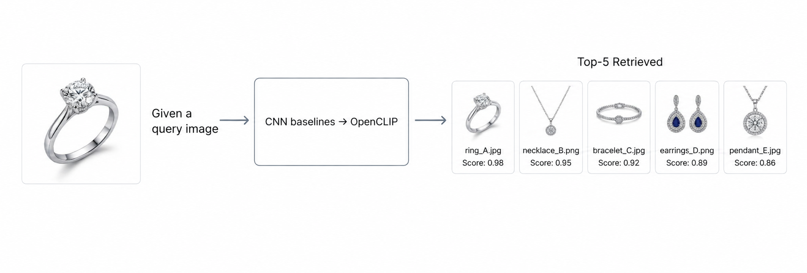

Fig. 1: Overview of the proposed retrieval framework, illustrating the query-driven input, progressive transition from CNN baselines to OpenCLIP, and Top-K retrieval with similarity scores.

## Related Work

### Fine-Grained Visual Retrieval and Domain-Specific Ornament Data

Fine-grained visual retrieval aims to identify near-duplicate or highly similar items where category-level appearance is insufficient and discrimination depends on subtle shape, texture, and structural cues. In practice, this regime is common in product and accessory search, including jewellery, where differences may be expressed through stone geometry, setting arrangement, band profile, and metal finish. Recent domain-adjacent resources illustrate both the interest and the data constraints typical of ornament-centric vision: OrnAsia provides a curated dataset of culturally significant ornaments such as rings, necklaces, and earrings captured with real-world variability in viewpoint and lighting, offering a small but realistic testbed for fine-grained recognition and retrieval evaluation (Nayeem et al., 2025). In parallel, jewellery-focused modelling has been explored for identification and textual description via neural networks, indicating ongoing demand for automated jewellery understanding and highlighting practical challenges such as stylistic diversity and the need for interpretable outputs (Alcalde-Llergo et al., 2025).

### CLIP-Style Vision-Language Pretraining as a Retrieval Backbone

The retrieval literature has increasingly treated CLIP/OpenCLIP-style dual encoders as a default foundation for similarity search, as they yield semantically structured embeddings useful across tasks. However, recent work also clarifies a major limitation for instance-level and fine-grained retrieval: semantic supervision can collapse visually distinct images with similar textual contexts into nearby representations, harming image-to-image similarity search. To address this, Schall et al. propose explicit optimization procedures that improve image retrieval while preserving the joint embedding space needed for text-to-image search, including sequential fine-tuning and pseudo-caption strategies. A later expanded study evaluates two-stage fine-tuning and multi-caption-image pairing as practical approaches to boost content-based image retrieval without sacrificing cross-modal functionality, motivating retrieval-first fine-tuning protocols when CLIP is deployed as a unified embedding system (Schall et al., 2024).

### Adapting CLIP for Retrieval Under Limited Data and Resource Constraints

A central methodological challenge for limited-data fine-tuning is achieving domain adaptation without catastrophic forgetting or semantic drift. Several recent approaches propose efficient or selective adaptation. ProLIP demonstrates that fine-tuning only the last visual projection layer of CLIP can yield strong few-shot adaptation without adding external modules, suggesting that targeted parameter updates can deliver substantial gains while preserving pretrained structure (Fahes et al., 2026). LiteEmbed instead adapts the text side by optimizing class embeddings in a subspace-aware manner, separating coarse semantic alignment from fine-grained discrimination, aiming to improve performance on rare or underrepresented classes while keeping the encoders frozen and preserving the global manifold (Agarwal et al., 2026).

Other work emphasizes operational realism in retrieval systems where embeddings are cached and indexed. NUDGE proposes a non-parametric approach that modifies stored embeddings directly to maximize k-NN retrieval accuracy, seeking fast improvement without full model fine-tuning, and explicitly aiming to constrain semantic distortion (Zeighami et al., 2024). At the user-interaction level, CLIP-Branches introduces an interactive fine-tuning loop that uses user-specified positives and negatives to refine retrieval behavior while leveraging efficient index structures for fast response (Lulf et al., 2024). For open-vocabulary retrieval, FOR proposes fine-tuning strategies that use closed-set labels while preserving vision-language associations, targeting improved retrieval without discarding open-set utility (Levi et al., 2025).

Label-free or label-light adaptation remains an active theme. LatteCLIP uses large multimodal models to generate synthetic texts for domain images and distils useful cues from noisy captions to enable unsupervised CLIP fine-tuning (Cao et al., 2024). Enomoto and Yamaguchi (2026) similarly construct synthetic image captions to enable multimodal objectives during fine-tuning and explicitly introduce supervised contrastive pressure to cluster same-class representations, which is aligned with retrieval deployment needs.

Complementing task-specific fine-tuning, broader post-pretraining refinement is also explored. TuneCLIP proposes a self-supervised fine-tuning framework for open-weight CLIP models, addressing optimization instabilities and false negatives in contrastive training to improve general performance across tasks, including retrieval, without requiring expensive training-from-scratch (Mehta et al., 2026). Zhang et al. (2026) propose semantic-aware adversarial fine-tuning using ensembles of refined textual descriptions to strengthen robustness while remaining grounded in CLIP-style similarity, highlighting the importance of robustness-oriented fine-tuning in forensic-like settings.

### Retrieval Losses, Embedding Geometry, and Retrieval-Aware Objectives

Recent analysis highlights that the choice of metric-learning objective shapes embedding geometry and ultimately Top-K ranking performance. Zeng et al. provide a comparative study of representative metric-learning losses and identify trade-offs between fast compaction and preserving fine-grained separability, offering practical guidance for selecting losses when top-1 discrimination is critical. These findings support curriculum-style training designs in which stable class-level supervision is established first via cross-entropy and then retrieval-oriented objectives such as supervised contrastive terms are introduced to refine neighbourhood structure.

### Benchmarks, Evaluation Protocols, and Retrieval Pipeline Practicalities

Evaluation practice has moved toward more realistic and contamination-aware benchmarks. Kordopatis-Zilos et al. (2025) introduce ILIAS, an instance-level image retrieval testbed at very large scale with diverse domains and non-saturated performance, and report that domain-tuned models can excel in narrow regimes while failing to generalize, reinforcing the need for cross-dataset testing and robust split governance. LookBench further proposes a live, time-stamped fashion retrieval benchmark explicitly designed to be updated over time, highlighting the importance of temporal governance for evaluation in an era of large pretrained models (Gao et al., 2026).

In parallel, composed image retrieval has become a major stress test for fine-grained retrieval, requiring models to retrieve a target image given a reference image and a textual modification. Recent works propose improved contextual modelling, uncertainty-aware probabilistic learning, complementary visual-semantic integration, and agentic training-free reasoning, illustrating growing emphasis on compositionality, robustness, and interpretability in ranking (Zhang et al., 2026; Tang et al., 2026; Ye et al., 2026; Yang, Pang and Yuan, 2026). Yang et al. (2026) argue that compressing generative multimodal reasoning into single-vector retrievers can degrade fine-grained capabilities, motivating careful objective design and diagnosis-driven refinement pipelines. Song et al. (2026) revisit evaluation by proposing fine-grained benchmarks constructed from image editing processes to better reflect realistic modification semantics.
Finally, deployment considerations increasingly motivate architectures that separate offline indexing from online query encoding. Even outside product domains, retrieval work continues to explore efficient dual-encoder designs and stability mechanisms for unsupervised retrieval, reinforcing the practicality of offline embedding databases paired with fast similarity computation at inference (Liu et al., 2026). Together, these trends align with retrieval-first jewellery matching pipelines that prioritize transparent Top-K evidence, controlled evaluation partitions, and stable embedding geometry under limited data.

## Dataset Description

The experimental dataset is organized for retrieval-first evaluation with strict split separation between supervised learning and gallery search. Labeled data are provided in three partitions (Train, Validation, Test), while a separate `stolen` gallery is reserved for retrieval ranking and is never used for supervised fitting. In total, the dataset contains 3320 training images, 1094 validation images, 538 test images, and a 413-image retrieval gallery. This structure supports fair model comparison and avoids information leakage between optimization and search-time evidence generation.

The figure below provides a visual overview of the dataset composition. The top row shows representative samples from the four target categories (Bracelet, Earring, Necklace, Ring), and the lower panels summarize split sizes and class-share statistics across labeled data.

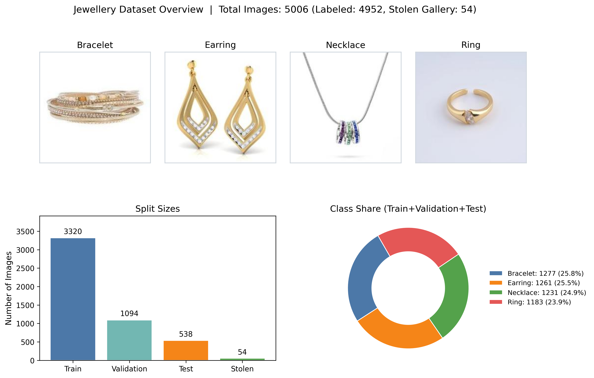

Fig 2: Dataset overview used in this study: representative jewellery samples by class, split sizes, and aggregate class-share distribution.

## Methodology

### Methodological Design Goals

This study is designed as a retrieval-oriented computer vision framework in which a single query jewellery image is used to identify the Top-K most visually similar items from a gallery of stolen jewellery images. The methodological design is guided by three linked objectives. First, the retrieval system must capture fine-grained visual properties that are central to jewellery identity, including stone shape, setting structure, band geometry, and metal tone. Second, model training must remain stable under limited-data conditions, where deep architectures are especially vulnerable to rapid overfitting and unstable generalization. Third, the complete pipeline must remain interpretable, reproducible, and sufficiently transparent for demonstration to non-specialist evaluators. These objectives shaped the decisions related to data preparation, model training, and retrieval-system construction.

### Data Preprocessing

Data preprocessing was treated as a controlled experimental component rather than as a routine loading operation. To preserve fairness across model families, the same partition policy and the same core preprocessing logic were enforced throughout the study. The curated jewellery dataset was organized into four labelled partitions together with one retrieval-only gallery partition, as summarized in the dataset overview. The training partition was used exclusively for supervised learning, the validation partition was reserved for model selection and checkpoint preservation, the test partition was retained for final metric reporting, and the stolen-jewellery partition served only as the retrieval gallery. This separation is methodologically important because it ensures that the gallery used in retrieval experiments does not influence feature learning during supervised training.

The distribution of classes across the labelled partitions is shown below. Although the imbalance is moderate, the validation and test partitions contain a comparatively larger proportion of necklace samples than the other classes. This has direct methodological implications. In particular, overall classification accuracy alone would not provide a sufficiently reliable description of model behaviour, since aggregated metrics can conceal class-specific weaknesses. For this reason, the evaluation strategy was designed to combine class-aware interpretation with embedding-space analysis so that both semantic discrimination and retrieval quality could be assessed more meaningfully.

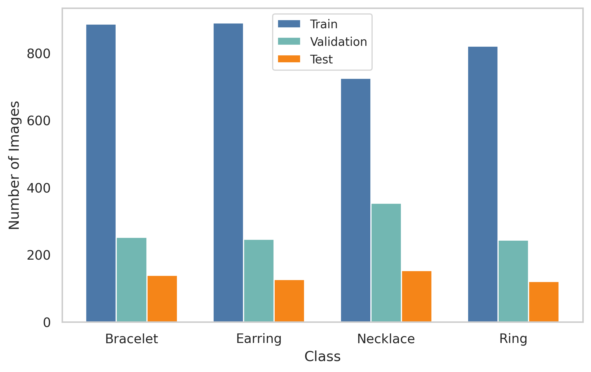

Fig. 3: Class distribution by split for the lebelled jewellery data. The figure visually highlights the moderate class imbalance across the trainning, validation, and test partitions.

Before model training, a strict rule-based cleaning protocol was applied. Corrupted or unreadable files were removed, only valid image formats were retained, and non-directory artifacts were excluded during class indexing in order to avoid label inconsistencies across runs. The training, validation, and test partitions were verified to be mutually disjoint, while all images assigned to the retrieval gallery were kept completely outside the supervised learning process. Filenames were preserved throughout the full pipeline so that every retrieval result could be traced back to its original image source. This traceability is particularly important in an investigative retrieval setting, where the credibility of the system depends not only on ranking quality but also on clear evidential correspondence.

The preprocessing policy was model-aware because pretrained visual encoders are sensitive to input statistics. Across all stages, images were converted to RGB and resized to 224 x 224, which provided an appropriate balance between computational efficiency and preservation of fine jewellery details. However, normalization was adapted to the assumptions of each pretrained backbone. For CNN-based stages, including VGG16, ResNet, and EfficientNet, ImageNet mean and standard deviation were used. For OpenCLIP-based stages, CLIP-specific normalization was adopted so that the input distribution remained aligned with the large-scale contrastive pretraining regime of the encoder. In the final retrieval stages, embedding normalization was also employed, with L2 normalization used to stabilize cosine-similarity geometry and improve nearest-neighbour consistency.

| Component | CNN Stages | OpenCLIP Stages |
|---|---|---|
| Resize | 224 x 224 | 224 x 224 |
| Normalization | ImageNet mean/std | CLIP mean/std |
| Train augmentation | Enabled | Enabled |
| Validation/Test augmentation | Disabled | Disabled |
| Embedding normalization | Optional per stage | L2 normalization enabled |

Table I: Preprocessing choices by model family

The augmentation strategy was intentionally conservative because jewellery retrieval depends on subtle local structures whose distortion may remove identity-relevant cues. Training-time augmentation therefore included only moderate perturbations, specifically random horizontal flipping with probability 0.5, random rotation up to 15 degrees, controlled color jitter, and in the final OpenCLIP pipeline, a mild random affine transformation with limited translation and scale variation. No stochastic augmentation was applied during validation, testing, or inference. This deterministic evaluation policy was adopted to ensure that the reported results reflected the learned representation itself rather than incidental performance variation caused by random transformations.

Leakage prevention and reproducibility were reinforced through additional controls. The retrieval gallery was never used for supervised fitting, validation and test images were always processed deterministically, and all runs were governed by a fixed seed (`SEED=42`) to reduce run-to-run variance. Furthermore, training artifacts were versioned by stage under structured output directories, making it possible to audit intermediate results and compare model stages consistently.

### Model Selection and Architecture Rationale

The methodological design of this study follows a progressive model-selection strategy in which multiple architectural families are evaluated before identifying a final retrieval-oriented solution. This progression serves two purposes. First, it establishes a fair comparative basis across conventional convolutional architectures and transformer-based visual encoders. Second, it allows the final model choice to be supported by empirical evidence rather than by architectural preference alone. In this framework, CNN baselines provide strong reference points for supervised jewellery recognition, whereas OpenCLIP-based models are examined for their ability to produce semantically rich and retrieval-consistent embeddings.

#### Candidate Models and Their Role

The candidate portfolio comprises three CNN-based baselines and two transformer-based variants. Each model was included with a distinct methodological role, ranging from classical high-capacity feature extraction to compact efficient representation learning and contrastively pretrained transformer encoding.

| Family | Implemented Variant | Embedding Dim. | Parameters (Approx.) | Methodological Role |
|---|---|---:|---:|---|
| CNN baseline 1 | VGG16 | 25,088 | 14.82M | Classical high-capacity baseline |
| CNN baseline 2 | EfficientNet-B0 | 1,280 | 4.01M | Strong compact CNN baseline |
| CNN baseline 3 | ResNet18 variants (single-phase and two-phase) | 512 | 11.18M | Residual-learning reference |
| Transformer baseline | OpenCLIP ViT-B/32 | 512 | 151.28M | Transitional CLIP stage |
| Final method | OpenCLIP ViT-L/14 | 768 | 427.62M | Primary retrieval model |

Table II: Candidate model portfolio used in the study.

This comparative design ensures alignment between the experimental checklist and the final system objective. The study therefore examines the behaviour of VGG16, EfficientNet-B0, and the ResNet18 baselines as representative CNN models, while the final deployed method is based on OpenCLIP ViT-L/14.

#### Why OpenCLIP Was Selected as the Final Method

OpenCLIP was selected as the final method because the comparative evidence indicated that it offers the strongest balance between transferable visual semantics and retrieval-oriented embedding structure. Unlike conventional supervised backbones trained only for class separation, CLIP-style pretraining encourages representations that preserve semantic similarity at the feature level. This characteristic is especially important in jewellery retrieval, where visually related items may differ only in subtle details of setting, shape, or material appearance.

A second reason for selecting OpenCLIP lies in the representational strength of the ViT-L/14 backbone. Its larger capacity enables the encoder to model fine-grained design cues more effectively than the smaller alternatives considered in the study. In addition, the embedding-based nature of the OpenCLIP representation aligns naturally with cosine-similarity ranking, which is the core retrieval mechanism used in the final system. Finally, the observed early best-checkpoint behaviour suggests that this model adapts efficiently to the dataset under a controlled fine-tuning strategy, reaching strong performance without requiring a long training horizon. Taken together, these characteristics make OpenCLIP ViT-L/14 the most suitable architecture for the final retrieval-first framework.

#### Final Model Architecture

The final model, implemented in `code/06_clip_l14/model.py`, is based on the OpenCLIP ViT-L/14 visual encoder and produces a 768-dimensional feature representation. During supervised training, this embedding is passed through an L2 normalization stage and then through a temporary linear classifier head that maps the representation to the four target jewellery categories. The classifier is used only to guide supervised adaptation during training. During inference and retrieval, this classification branch is discarded, and only the normalized embedding is retained for similarity-based search.

Fig. 4: Final model architecture in training mode. The OpenCLIP ViT-L/14 visual encoder generates a 768-dimensional embedding, which is L2-normalized and fed into a temporary classification head for supervised learning. During retrieval inference, the classifier is discarded, and only the normalized embedding is used for cosine similarity-based retrieval.

### Training Strategy and Justification of Design Choices

The training procedure of the final method was designed to satisfy two methodological requirements simultaneously: stable adaptation under small-data conditions and direct optimization for retrieval performance. Rather than applying unrestricted end-to-end fine-tuning from the outset, the model was trained through a structured multi-phase curriculum. This strategy reduces the risk of destabilizing pretrained representations at an early stage while gradually reshaping the feature space toward the retrieval objective.

#### Multi-Phase Training Design

The final system employs automatic phase transitions across three training stages. In the first phase, the optimization is focused on stabilizing the classification head while largely preserving the pretrained structure of the backbone. In the second phase, the backbone is unfrozen and gently adapted together with the classification head using differential learning rates. In the third phase, the model remains trainable end-to-end, but the optimization objective shifts from pure category supervision to a retrieval-aware formulation based on supervised contrastive learning combined with cross-entropy. This progression allows the model to first establish stable class-level semantics and then refine the embedding space for nearest-neighbour ranking.

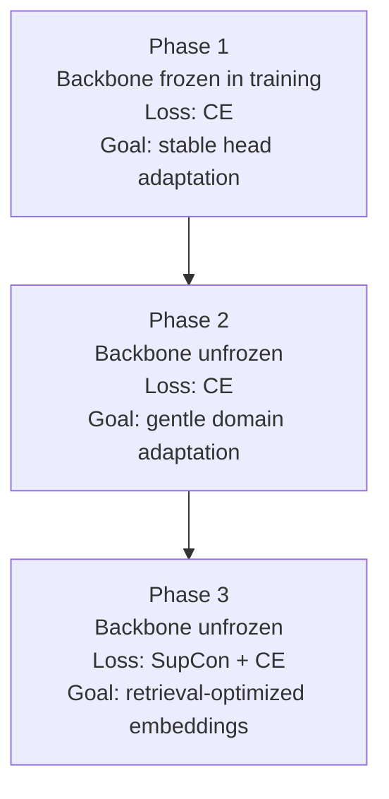

Fig. 5: Training curriculum of the final method. The optimization proceeds from stable supervised adaptation to retrieval-aware embedding refinement.

| Phase | Trainable Scope | Loss | Learning-Rate Policy | Transition Rule |
|---|---|---|---|---|
| Phase 1 | Classifier head focused (backbone frozen in intent) | CE | Head: 1e-4 | Until accuracy threshold or maximum phase epochs |
| Phase 2 | Backbone + head | CE | Backbone: 1e-6, Head: 1e-4 | Until accuracy threshold or maximum phase epochs |
| Phase 3 | Backbone + head | SupCon + CE | Backbone: 5e-7, Head: 5e-5 | Until configured budget; best checkpoint retained |

Table III: Phase configuration of the final method.

This multi-phase strategy is methodologically justified because it protects pretrained features in the early stage of training, reduces the risk of catastrophic forgetting on a limited dataset, and introduces contrastive embedding pressure only after the model has already learned stable class-level discrimination.

#### Loss Function Design

The loss design follows the same progressive logic as the training curriculum. During Phases 1 and 2, cross-entropy is used as the sole objective because it provides stable supervised gradients and quickly calibrates the decision boundaries between the four jewellery categories. This creates a reliable semantic foundation before the model is asked to optimize embedding geometry explicitly.

In Phase 3, the objective is extended by combining supervised contrastive loss with cross-entropy. The supervised contrastive term encourages embeddings of samples from the same class to become more compact while pushing samples from different classes further apart. This behaviour directly supports retrieval performance, since Top-K ranking depends on the geometric structure of the embedding space rather than on classifier logits alone. The cross-entropy term is retained with a smaller weight in order to preserve class-level consistency and prevent semantic drift during contrastive optimization.

$$
\mathcal{L}_{\text{SupCon}} =
\sum_i \frac{-1}{|P(i)|}\sum_{p\in P(i)}
\log
\frac{\exp(z_i \cdot z_p/\tau)}{\sum_{a\neq i}\exp(z_i \cdot z_a/\tau)}
$$

$$
\mathcal{L}_{\text{CE}} = -\sum_{c=1}^{C} y_c \log(\hat{y}_c)
$$

$$
\mathcal{L}_{\text{total}} = 1.0 \cdot \mathcal{L}_{\text{SupCon}} + 0.1 \cdot \mathcal{L}_{\text{CE}}
$$

This formulation is appropriate because it jointly optimizes semantic discrimination and retrieval-oriented representation structure, thereby aligning the training objective with the practical behaviour required at inference time.

#### Optimizer Selection

AdamW was selected as the optimizer for all stages of the final method. This choice is motivated by the fact that decoupled weight decay provides more stable regularization for deep pretrained backbones than classical L2-coupled formulations. In transformer fine-tuning, AdamW is widely regarded as an effective optimization strategy because it supports smoother convergence while maintaining conservative update behaviour. These characteristics are particularly important in the present setting, where the dataset is relatively small and the pretrained representation must be adapted without being disrupted.

#### Learning-Rate Policy

The learning-rate policy is both differential and phase-dependent. Higher learning rates are assigned to the classification head so that task-specific adaptation can proceed efficiently, whereas the backbone is updated with substantially smaller learning rates in order to preserve the useful structure learned during pretraining. This asymmetry becomes even more important in the final phase, where contrastive learning could otherwise destabilize the mature representation. A cosine annealing schedule is used to smooth the late-stage optimization trajectory and support more stable convergence as training progresses.

#### Effective Epoch Budget

Although each experiment was configured with a 100-epoch training budget, the effective optimization horizon of the final model was governed by validation-based checkpoint selection. In practice, the strongest validation behavior emerged early relative to the full budget, which is consistent with the overfitting profile expected in small and visually clean datasets. For this reason, the methodology treats the 100-epoch budget as a common upper bound for fair comparison, while using early checkpoint retention as the principled stopping mechanism for final model selection.

#### Overfitting Control Strategy

Overfitting control was treated as an integral part of the training design rather than as an afterthought. Because the dataset consists primarily of clean e-commerce-style jewellery images, memorization can emerge quickly if the optimization is allowed to proceed too aggressively. To limit this risk, the training process relied on moderate augmentation only, a weight-decay value of 1e-4, continuous validation monitoring, staged learning-rate reduction, and conservative backbone updates. In combination, these measures provide a stable regularization framework without excessively restricting model adaptation.

#### Training Algorithm

The overall training procedure can be summarized by the following retrieval-aware multi-phase algorithm:

1. Input `train_loader`, `val_loader`, OpenCLIP backbone, and configuration.
2. Initialize the model with a temporary classifier head.
3. Set `phase = 1`.
4. While `phase <= 3`:
   - Configure trainable parameters and learning-rate groups for the current phase.
   - Configure loss: CE for Phases 1-2, SupCon + CE for Phase 3.
   - For each epoch in the current phase budget:
     - Train one epoch.
     - Validate and record metrics.
     - Save the best checkpoint when validation improves.
     - Break early if the transition rule is satisfied.
   - Increment the phase.
5. Return the best checkpoint.

#### Hyperparameter Justification

The principal hyperparameters of the final method were selected to balance computational feasibility, optimization stability, and resistance to overfitting.

| Hyperparameter | Value Used | Rationale |
|---|---|---|
| Batch size | 32 | Balanced for memory usage and gradient stability on a Colab-class GPU |
| Input size | 224 | Preserves sufficient visual detail with manageable computational cost |
| CE loss | Enabled | Provides a stable supervised optimization baseline |
| SupCon temperature | 0.07 | Standard effective temperature in the supervised contrastive literature |
| Optimizer | AdamW | Supports stable fine-tuning of pretrained transformer backbones |
| Weight decay | 1e-4 | Controls overfitting without causing strong underfitting |
| Head LR (P1/P2/P3) | 1e-4, 1e-4, 5e-5 | Enables fast adaptation followed by controlled refinement |
| Backbone LR (P2/P3) | 1e-6, 5e-7 | Preserves pretrained structure while allowing gradual adaptation |
| Scheduler | Cosine | Provides smooth late-stage decay of parameter updates |
| Effective epochs | 100-epoch budget with early checkpoint retention | Preserves fair comparison while limiting overfitting |

Table IV: Hyperparameter justification matrix
  

| Category | Documented Elements |
|---|---|
| Data and preprocessing | Split-wise sample counts documented; class distribution documented; model-specific normalization documented; train-time augmentation documented; test-time deterministic policy documented. |
| Training strategy | Loss choice justified; optimizer choice justified; learning-rate policy justified; epoch policy justified; multi-phase strategy justified. |
| Pipeline and proof | Context diagram included; technical pipeline diagram included; retrieval proof figure included; Top-5 filenames with similarity scores included. |

Table V: Reproducibility checklist for the proposed methodology.

### System Architecture and Retrieval Pipeline

This study evaluates six architecture-level designs in a progressive sequence and then consolidates them into a deployment-oriented retrieval framework. The progression is intentionally structured to move from classical convolutional encoders to transformer-based metric representations while preserving a common evaluation protocol. For each model variant, the methodological description covers network composition, optimization policy, and inference behavior so that differences in performance can be linked to concrete design decisions.

#### A. VGG16 Baseline

The VGG16 baseline uses an ImageNet-pretrained VGG16 feature extractor and replaces the original classifier stack with a task-specific linear layer for four jewellery categories. In implementation, convolutional feature maps are processed by an adaptive 7 x 7 pooling layer and flattened to a 25,088-dimensional representation before classification. This high-dimensional descriptor is also retained as the embedding used for retrieval-oriented analysis, enabling direct comparison between class-discriminative and similarity-based behavior within the same model.

Optimization is performed with single-phase end-to-end fine-tuning. Cross-entropy is used as the primary objective, AdamW is used for parameter updates (1e-4 learning rate, 1e-4 weight decay), and cosine annealing is applied across the full epoch budget. The training pipeline operates at 224 x 224 resolution with batch size 32, mixed-precision updates, and moderate augmentation (horizontal flip, small rotation, and color jitter). Validation and test processing remain deterministic to avoid stochastic evaluation variance.

At inference, two pathways are used. The first pathway performs conventional classification using logits from the final linear head. The second pathway extracts the pooled pre-classifier embedding and performs cosine-similarity ranking against gallery embeddings. This dual-path protocol is useful for diagnosing whether class accuracy and retrieval geometry are aligned or partially decoupled.

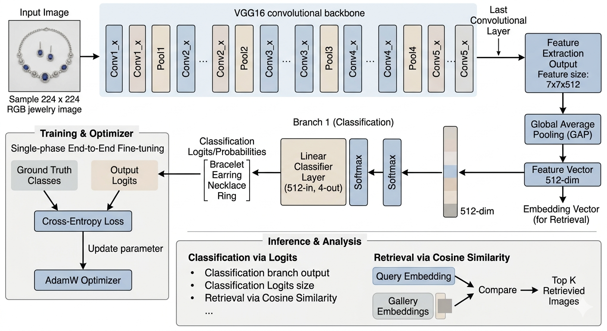

Fig. 7: VGG16 baseline architecture and inference path.

#### B. ResNet18 Baselines

The ResNet-family reference is implemented with ResNet18 to provide a residual-learning baseline under moderate computational cost. The architecture removes the original fully connected classifier, keeps the convolutional backbone up to global pooling, and maps the resulting 512-dimensional feature vector to four output classes through a new linear head. The pooled feature is simultaneously treated as the retrieval descriptor, which makes comparative retrieval analysis directly attributable to residual feature learning quality.

Two ResNet18 training variants are used in the study. A single-phase control trains the full network end-to-end under the common CNN protocol and serves as a lightweight reference in the quantitative comparisons. The principal ResNet18 baseline then extends the same architecture with a two-phase curriculum. In Phase 1, the backbone is frozen and only the classification head is trained for 30 epochs at a head learning rate of 1e-3, allowing stable adaptation of decision boundaries without perturbing pretrained residual filters. In Phase 2, the backbone is unfrozen and optimized jointly with the head for 70 epochs using differential learning rates (1e-5 for backbone, 1e-4 for head) and AdamW. This differential policy is designed to prevent catastrophic drift in pretrained low-level filters while still permitting domain-specific adaptation in higher layers.

Inference mirrors the VGG16 baseline protocol. Logits are used for categorical prediction, while the global pooled vector is used for cosine-based retrieval. Because the same embedding source is used in both training and evaluation, the ResNet18 variants provide a clear view of how end-to-end training and freeze-unfreeze training affect embedding compactness and neighbourhood structure.

Fig. 8: ResNet18 baseline with two-phase training and dual inference branches.

#### C. EfficientNet-B0 Baseline

EfficientNet-B0 is used as the compact high-capacity CNN baseline. The implementation retains the pretrained feature stem and MBConv hierarchy, applies adaptive global pooling, and replaces the terminal classifier with a four-class linear layer. The pooled representation has 1,280 dimensions and is reused as the retrieval embedding, which provides a lower-dimensional alternative to the VGG descriptor while preserving strong discriminative behavior.

Training follows a single-phase, full-network fine-tuning protocol to maintain fairness with the other single-phase baselines. The optimization stack remains cross-entropy with AdamW, 224 x 224 resolution, batch size 32, weight decay 1e-4, and cosine annealing over the configured epoch budget. Mixed precision and the same augmentation family are retained so that observed differences reflect architecture effects rather than preprocessing differences.

Inference again uses a dual interpretation of the network output. Classification is computed from logits, whereas retrieval uses cosine ranking over the pooled feature embedding. This model is methodologically important because it establishes the strongest CNN reference before transition to transformer-based encoders.

Fig. 9: EfficientNet-B0 baseline architecture with retrieval
embedding branch.

#### D. OpenCLIP ViT-B/32 Transitional Model

The transitional OpenCLIP configuration introduces transformer-based visual encoding through OpenCLIP ViT-B/32. The visual branch of CLIP is used as the backbone encoder, and its output is passed through an identity or learned projection block depending on dimensional compatibility with the configured embedding space. In this configuration, a 512-dimensional embedding is produced and L2-normalized to stabilize cosine geometry. A lightweight linear classifier is attached only for supervised optimization.

The training objective in this transitional configuration remains cross-entropy with single-phase optimization, intentionally avoiding additional metric-learning terms so that the effect of architecture transition can be isolated from objective-function changes. AdamW, cosine scheduling, mixed precision, CLIP normalization statistics, and deterministic validation/testing are retained for consistency with the global experimental protocol.

At inference, logits are available for category prediction, but the principal analytical output is the normalized embedding used for nearest-neighbour retrieval. This model therefore acts as an architectural bridge between CNN-centric baselines and the final multi-phase OpenCLIP retrieval system.

Fig. 10: OpenCLIP ViT-B/32 transitional architecture.

#### E. Final Method: OpenCLIP ViT-L/14 Retrieval System

The final model upgrades the encoder to OpenCLIP ViT-L/14 and uses a 768-dimensional embedding space. In implementation, the visual transformer is loaded with OpenAI pretrained weights and configured to match the expected QuickGELU setting for this checkpoint family. A temporary linear classifier head is attached during training, whereas deployment uses only the normalized embedding branch. This separation between training head and inference embedding avoids unnecessary classification constraints during retrieval deployment.

Training is organized as an automatic three-phase curriculum designed for small-data stability. Phase 1 trains only the classifier head with a frozen backbone and cross-entropy, providing rapid task alignment without disturbing pretrained transformer structure. Phase 2 unfreezes the backbone and applies differential learning rates (1e-6 for backbone, 1e-4 for head), still with cross-entropy, to introduce controlled domain adaptation. Phase 3 retains the unfrozen setting but shifts to the combined objective of the final loss equation, with lower learning rates (5e-7 backbone, 5e-5 head) and cosine scheduling for refinement. Phase transitions are triggered automatically using phase-wise epoch caps and training-accuracy thresholds, and checkpoint selection is based on validation loss to limit overfitting.

Deployment-time inference is purely retrieval-oriented. A query image is deterministically preprocessed, encoded to a normalized embedding, and compared with the offline gallery index using cosine similarity:

$$
\text{sim}(q, d_i) = \frac{q^\top d_i}{\|q\|_2 \|d_i\|_2}
$$

The system then returns Top-K ranked matches with image filenames and similarity scores, which satisfies the retrieval-proof requirement in an auditable format.

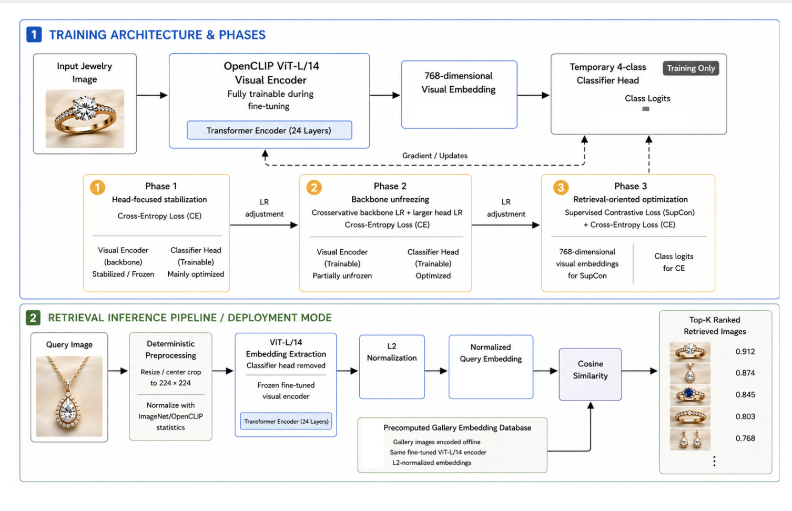

Fig. 11: Final OpenCLIP ViT-L/14 architecture with three-phase training and retrieval inference.

#### F. Unified Retrieval Pipeline View

To support interpretability for mixed technical audiences, the complete operational flow is summarized as a unified online-offline pipeline. In the offline step, stolen-jewellery gallery images are encoded once and stored with their file-path metadata as a searchable embedding database. In the online step, each incoming query image is encoded, compared to the gallery index, ranked by cosine similarity, and returned as evidence-ready Top-K outputs. This decomposition clarifies system behavior, computational responsibilities, and reporting traceability in a single view.

Fig. 12: Unified retrieval pipeline from query image to
Top-K ranked stolen items.

## Results

### Quantitative Outcomes

The results are reported from model-specific artifacts in the shared evaluation pipeline. All reported checkpoints come from runs configured with a 100-epoch training budget (`NUM_EPOCHS = 100`). The table below summarizes the principal metrics (mAP and nearest-centroid embedding accuracy), while the following table reports cross-dataset retrieval behavior for the stricter Val -> Test protocol.

| Model | Epochs | mAP | Emb. Acc. |
|---|---:|---:|---:|
| ResNet18 (single-phase) | 100 | 0.6860 | 0.8086 |
| VGG16 | 100 | 0.6817 | 0.8810 |
| EfficientNet-B0 | 100 | 0.8966 | 0.9257 |
| ResNet18 (two-phase) | 100 | 0.6617 | 0.9033 |
| OpenCLIP ViT-B/32 (CE-only) | 100 | 0.3267 | 0.4015 |
| OpenCLIP ViT-L/14 (final) | 100 | **0.9235** | **0.9368** |

TABLE VI: Core model-wise metrics on the test set (N =538)

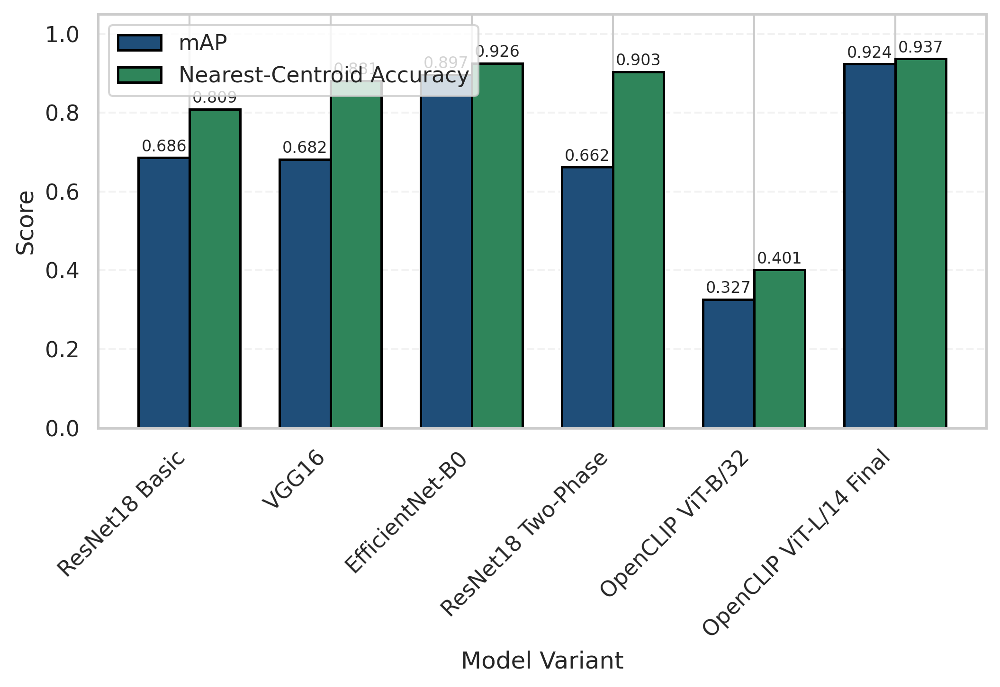

Fig. 13: Model-wise comparison of mAP and nearestcentroid embedding accuracy.

The strongest CNN baseline on mAP is EfficientNet-B0. Relative to it, the final OpenCLIP ViT-L/14 model improves mAP by +0.0270 (from 0.8966 to 0.9235) and embedding accuracy by +0.0112 (from 0.9257 to 0.9368), confirming that the multi-phase strategy yields measurable gains beyond the best CNN setting. Under the cross-dataset Val -> Test protocol, the final model leads on R@1 and R@5, while the ResNet18 two-phase variant records the highest R@10 and R@20, indicating that its recall saturation at higher K values may be partly attributable to its curriculum rather than superior embedding geometry.

| Model | R@1 | R@5 | R@10 | R@20 |
|---|---:|---:|---:|---:|
| ResNet18 (single-phase) | 0.8135 | 0.9452 | 0.9717 | 0.9817 |
| VGG16 | 0.8647 | 0.9570 | 0.9799 | 0.9890 |
| EfficientNet-B0 | 0.9223 | 0.9753 | 0.9845 | 0.9899 |
| ResNet18 (two-phase) | 0.8583 | 0.9790 | **0.9945** | **0.9973** |
| OpenCLIP ViT-B/32 (CE-only) | 0.3455 | 0.7952 | 0.9442 | 0.9890 |
| OpenCLIP ViT-L/14 (final) | **0.9442** | **0.9854** | 0.9890 | 0.9927 |

TABLE VII: Cross-dataset retrieval recall (Val → Test).

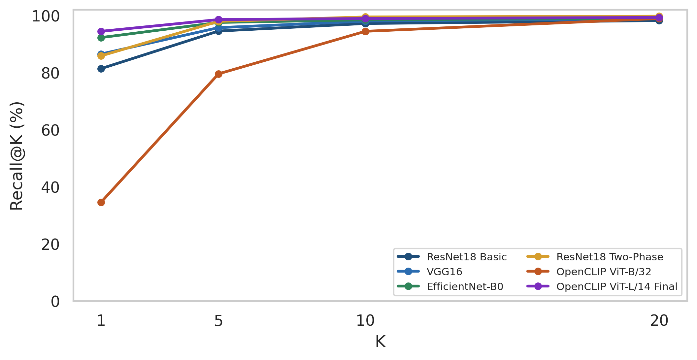

Fig. 14: Cross-dataset Recall@K comparison under Val →
Test retrieval.

### Class-Wise and Visual Analysis

Class-wise behavior indicates that the transitional OpenCLIP ViT-B/32 model under CE-only training is substantially weaker than strong CNN baselines, especially for necklace and ring categories.

| Class | EffB0 | ViT-B/32 | Delta (EffB0 - ViT) |
|---|---:|---:|---:|
| Bracelet | 0.88 | 0.48 | +0.40 |
| Earring | 0.98 | 0.55 | +0.43 |
| Necklace | 0.94 | 0.16 | +0.78 |
| Ring | 0.91 | 0.25 | +0.66 |

TABLE VIII: Class-wise F1-score comparison (EfficientNet-B0 vs OpenCLIP ViT-B/32).

Stronger models show tighter clusters and cleaner class boundaries, consistent with higher mAP and macro-level F1.

### Retrieval Proof, Overfitting, and Inference Latency

For retrieval proof, the query image `Test/Ring/0SN5DLECJV9H.jpg` returned the Top-5 matches listed below and visualized in the accompanying figure. The outputs include filenames and cosine scores, satisfying traceability requirements for demonstration.

| Rank | Filename | Cosine |
|---|---|---:|
| 1 | `37_1-1.jpg` | 0.8676 |
| 2 | `11_1-5.jpg` | 0.8605 |
| 3 | `151000004a.jpg` | 0.8553 |
| 4 | `3_1-7.jpg.jpg` | 0.8541 |
| 5 | `131000113.jpg` | 0.8496 |

TABLE IX: Top-5 retrieval proof (final model).

Fig. 15: Top-5 retrieval proof for the ring query image in
the final system.

Overfitting behavior is visible in long-run diagnostics: train accuracy rises to 99.97% while validation accuracy stabilizes near 96.89%, and CE-loss curves diverge between train and validation at later steps. This pattern is expected for a small, clean, e-commerce-style dataset and supports the use of short effective training horizons and checkpoint-based stopping.

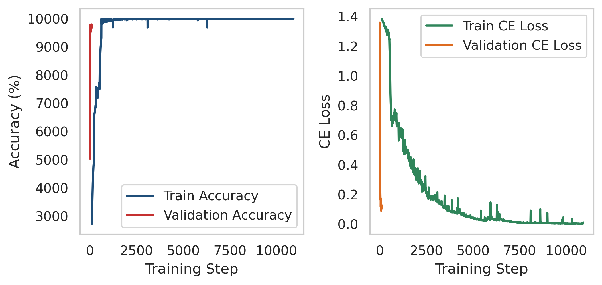

Fig. 16: Overfitting diagnostic from a long training run
(train vs validation trends).

| Metric | Seconds/query |
|---|---:|
| Mean | 0.4167 |
| Median | 0.3934 |
| Minimum | 0.3408 |
| Maximum | 0.5682 |

TABLE X: Retrieval latency on CPU (20 queries, Top-5).

The latency table indicates that the final retrieval pipeline remains practical for small galleries (N = 54) even on CPU.

### Pipeline Integrity and Data Validation

An integrity check identified hidden `.DS_Store` files in the dataset directory tree. These artifacts can introduce class-index drift when class folders are derived from unfiltered directory listings. After enforcing hidden-file filtering in the final pipeline and regenerating embeddings and evaluation artifacts, cross-dataset recall became consistent with mAP, embedding accuracy, class-wise trends, and retrieval-proof outputs. The consolidated visual diagnostics for confusion behavior and embedding geometry are provided below.

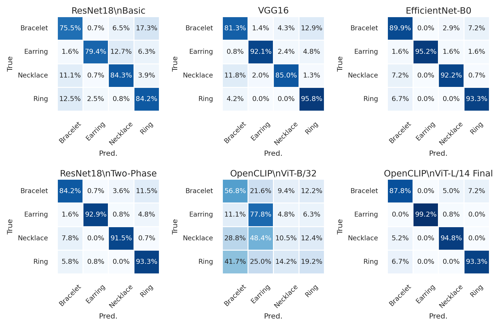

Fig. 17: Confusion-matrix comparison across baseline and final models (row-normalized percentages).

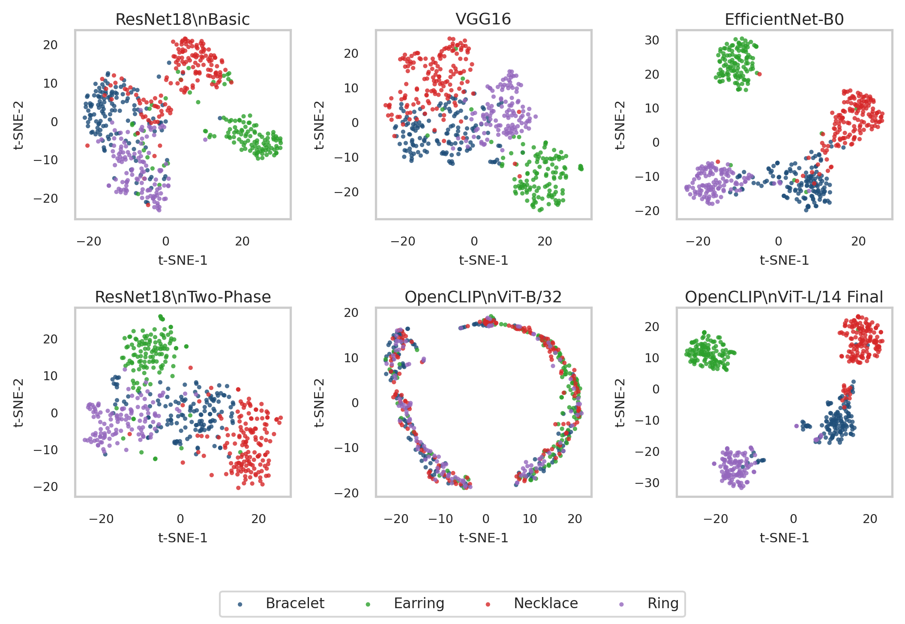

Fig. 18: Embedding-space (t-SNE) comparison across baseline and final models

## Discussion

### Interpretation of Findings

Under the same 100-epoch training budget, the final OpenCLIP ViT-L/14 configuration achieved the strongest retrieval-centric performance in this study, with the highest mAP and embedding-classification accuracy. Relative to the strongest CNN baseline (EfficientNet-B0), the final model improved mAP by +0.0270 and nearest-centroid embedding accuracy by +0.0112. In a small, visually clean jewellery dataset where multiple models can quickly obtain high same-split scores, these gains are practically meaningful. The broader interpretation is that model quality in this project is better reflected by retrieval geometry and ranked-neighbor behavior than by logits-only classification outcomes.

### Why the Final OpenCLIP Method Performed Better

The final model outperformed the CNN baselines primarily because of representation quality. First, large-scale contrastive pretraining provides stronger semantic priors for subtle visual attributes such as stone layout, setting structure, and band profile. Second, the multi-phase objective design aligns optimization with the retrieval target: cross-entropy stabilizes category separation early, while the final SupCon+CE phase improves intra-class compactness and inter-class separation in cosine space. Third, progressive transfer (head stabilization, controlled backbone unfreezing, retrieval-aware refinement) reduces early feature drift and improves convergence stability under small-data conditions. The strong improvement over the CE-only OpenCLIP ViT-B/32 baseline indicates that both architecture capacity and training curriculum contributed to final performance.

### Impact of Dataset Characteristics

Dataset structure strongly affected experimental behavior. Because the images are mostly e-commerce style with controlled backgrounds and lighting, memorization risk is high and same-split retrieval can appear near-saturated. This motivates the use of multi-view evaluation (mAP, cross-dataset recall, class-wise trends, and embedding-space diagnostics) instead of a single headline metric. The observed train-validation divergence in long-run diagnostics is consistent with this setting and supports the use of conservative optimization, checkpoint-based model selection, and explicit overfitting acknowledgment.

### Practical Implications

From a system perspective, the final retrieval pipeline is operationally practical for small galleries. With precomputed gallery embeddings, exact cosine ranking over N = 54 items produced usable CPU latency. The output format of Top-K images, filenames, and similarity scores is also suitable for traceable demonstration workflows. Accordingly, the final method is a better fit than the tested CNN baselines for retrieval-first jewellery matching, while still requiring cautious interpretation when moving beyond the current dataset domain.

## Ethical Considerations

Although this project focuses on product images rather than biometric identity, ethical data governance remains essential. Dataset use should be tied to documented permission or license compliance, with provenance records for source, acquisition context, and usage scope, and any linked metadata should be handled under data-minimization and controlled-access principles. The training distribution is limited and visually homogeneous, which introduces domain bias toward clean catalog imagery and may reduce reliability for real-world jewellery photos with clutter, illumination variation, occlusion, or uncommon design styles, so reported performance should not be interpreted as uniformly fair across all jewellery subdomains. In addition, image-retrieval technology is inherently dual-use: a system intended for investigative support can be misapplied for unauthorized tracking, profiling, or surveillance workflows. For that reason, deployment should enforce purpose limitation, role-based access, and query-level auditability, while retrieval outputs must be treated as decision support rather than decision authority. Responsible use also requires transparency about limitations, overfitting risk, and pipeline integrity constraints, and each retrieval result should ideally be accompanied by an auditable evidence package including the query image, returned candidates, similarity scores, model version, and file-level traceability.

## Limitations

The main limitation of this work is dataset scale and diversity. Although the curated images are clean and well structured, the dataset is relatively small for deep retrieval learning and is dominated by e-commerce-style capture conditions, so the model may be less reliable under real-world shifts such as cluttered backgrounds, severe illumination changes, motion blur, or partial occlusion. The current supervision is also category-level (bracelet, earring, necklace, ring), which is sufficient for retrieval-first benchmarking but does not encode finer attributes such as stone type, setting subtype, hallmark details, or micro-texture cues; accordingly, the system should not yet be interpreted as a complete fine-grained forensic identifier. Overfitting remains a structural risk in this small-data regime, as shown by train-validation divergence in long-run diagnostics, and the study further showed that retrieval metrics are sensitive to data-pipeline hygiene, since hidden-file artifacts can disturb class indexing if directory scanning is not strictly controlled.

## Conclusion

This work introduced and validated a retrieval-first jewellery matching pipeline that compares multiple baseline families against a final OpenCLIP ViT-L/14 model. Under a common 100-epoch budget, the final method achieved the strongest overall retrieval performance with mAP = 0.9235, nearest-centroid embedding accuracy = 0.9368, and strong cross-dataset retrieval (R@1 = 0.9442, R@5 = 0.9854, R@10 = 0.9890, R@20 = 0.9927).

Beyond metrics, the system provides auditable Top-K retrieval proof with filename-level traceability and practical CPU inference for small galleries after offline indexing. Overall, the findings indicate that retrieval-optimized transformer embeddings are better suited than the tested CNN baselines for this dataset and objective, while still requiring careful governance under distribution shift and high-stakes use.

## Future Work

Future work should first expand data coverage through larger sample size, more realistic photo conditions, and broader jewellery design diversity, while moving annotation beyond coarse category labels toward attribute-aware and instance-aware supervision for finer retrieval decisions. On the modelling side, stronger metric-learning refinements such as hard-negative strategies, proxy losses, and calibration-aware objectives should be investigated, alongside multimodal retrieval that combines image embeddings with structured textual metadata to improve robustness when visual evidence is ambiguous. For deployment at larger gallery scale, exact cosine search should be replaced with approximate nearest-neighbour indexing such as FAISS and accompanied by explicit speed-accuracy benchmarking, continual drift monitoring, audit logging, and human-in-the-loop review interfaces so the system remains assistive, transparent, and accountable in operational settings.

## References

1. Nayeem, M.D., Sraboni, S.Z., Biswas, S.S. and Islam, M.M. (2025) ‘OrnAsia: A dataset of asian ornaments for image classification and cultural identification’, Data in Brief, 63, p. 112195. doi: https://doi.org/10.1016/j.dib.2025.112195
2. Alcalde-Llergo, J.M., Ruiz-Mezcua, A., Avila-Ramirez, R., Zingoni, A., Taborri, J. and Yeguas-Bolivar, E. (2025) ‘Automatic identification and description of jewelry through computer vision and neural networks for translators and interpreters’, Applied Sciences, 15(10), p. 5538. doi: https://doi.org/10.3390/app15105538
3. Schall, K., Barthel, K.U., Hezel, N. and Jung, K. (2024) Optimizing CLIP models for image retrieval with maintained joint-embedding alignment. arXiv preprint. Available at: https://arxiv.org/abs/2409.01936
 (Accessed: 1 February 2026).
4. K. Schall, K. U. Barthel, N. Hezel, and A. Moelle, “A comprehensive approach to improving CLIP-based image retrieval while maintaining joint-embedding alignment,” *Information Systems*, 2025. Available: https://www.sciencedirect.com/science/article/pii/S0306437925000651
5. Fahes, M., Vu, T.-H., Bursuc, A., Perez, P. and de Charette, R. (2026) Fine-tuning CLIP’s last visual projector: A few-shot cornucopia. arXiv preprint. Available at: https://arxiv.org/abs/2410.05270
 (Accessed: 1 February 2026).
6. Agarwal, A., Karanam, S. and Gandhi, V. (2026) LiteEmbed: Adapting CLIP to rare classes. arXiv preprint. Available at: https://arxiv.org/abs/2601.09661 (Accessed: 1 February 2026).
7. Zeighami, S., Wellmer, Z. and Parameswaran, A. (2024) NUDGE: Lightweight non-parametric fine-tuning of embeddings for retrieval. arXiv preprint. Available at: https://arxiv.org/abs/2409.02343 (Accessed: 1 February 2026).
8. Lulf, C., Martins, D.M.L., Salles, M.A.V., Zhou, Y. and Gieseke, F. (2024) CLIP-branches: Interactive fine-tuning for text-image retrieval. arXiv preprint. Available at: https://arxiv.org/abs/2406.13322 (Accessed: 1 February 2026).
9. Levi, H., Heller, G. and Levi, D. (2025) ‘FOR: Finetuning for object level open vocabulary image retrieval’, in Proceedings of the IEEE/CVF Winter Conference on Applications of Computer Vision (WACV). Available at: https://arxiv.org/abs/2412.18806 (Accessed: 3 February 2026).
10. Cao, A.-Q., Jaritz, M., Guillaumin, M., de Charette, R. and Bazzani, L. (2024) LatteCLIP: Unsupervised CLIP fine-tuning via LMM-synthetic texts. arXiv preprint. Available at: https://arxiv.org/abs/2410.08211 (Accessed: 3 February 2026).
11. Enomoto, S. and Yamaguchi, S. (2026) Multimodal fine-tuning with synthetic captions. arXiv preprint. Available at: https://arxiv.org/abs/2601.21426 (Accessed: 3 February 2026).
12. Mehta, A., Wei, X., Chen, X. and Yang, T. (2026) Breaking the limits of open-weight CLIP: An optimization framework for self-supervised fine-tuning of CLIP. arXiv preprint. Available at: https://arxiv.org/html/2601.09859v1 (Accessed: 3 February 2026).
13. Zhang, J., Li, J., Huang, H., Erfani, S.M., Rubinstein, B.I.P. and Liu, F. (2026) Semantic-aware adversarial fine-tuning for CLIP (SAFT). arXiv preprint. Available at: https://arxiv.org/abs/2602.12461 (Accessed: 3 February 2026).
14. Zeng, D., Niu, H., Li, Z. and Taya, M. (2026) Variance & greediness: A comparative study of metric-learning losses. arXiv preprint. Available at: https://arxiv.org/abs/2601.21450 (Accessed: 3 February 2026).
15. Kordopatis-Zilos, G., Stojnic, V., Manko, A., Suma, P., Ypsilantis, N.-A., Efthymiadis, N., Laskar, Z., Matas, J., Chum, O. and Tolias, G. (2025) ‘ILIAS: Instance-level image retrieval at scale’, in Proceedings of the IEEE/CVF Conference on Computer Vision and Pattern Recognition (CVPR). Available at: https://openaccess.thecvf.com/content/CVPR2025/papers/Kordopatis-Zilos_ILIAS_Instance-Level_Image_retrieval_At_Scale_CVPR_2025_paper.pdf (Accessed: 3 February 2026).
16. Gao, C., Xue, S., Peng, Y., Fu, J., Gu, T., Li, S. and Zhou, F. (2026) LookBench: A live and holistic open benchmark for fashion image retrieval. arXiv preprint. Available at: https://arxiv.org/abs/2601.14706 (Accessed: 3 February 2026).
17. Zhang, M., Li, Z., Chen, Z., Fu, Z., Zhu, X., Nie, J., Wei, Y. and Hu, Y. (2026) HINT: Composed image retrieval with dual-path compositional contextualized network. arXiv preprint. Available at: https://arxiv.org/abs/2603.26341
 (Accessed: 5 February 2026).
18. Tang, H., Wang, J., Zhao, M., Meng, G., Luo, R., Chen, L. and Xia, S.-T. (2026) Heterogeneous uncertainty-guided composed image retrieval with fine-grained probabilistic learning. arXiv preprint. Available at: https://arxiv.org/abs/2601.11393
 (Accessed: 5 February 2026).
19. Ye, Y., Zhang, K., Zhang, Y., Chen, E., Li, L. and Zhou, J. (2026) Fine-grained zero-shot composed image retrieval with complementary visual-semantic integration. arXiv preprint. Available at: https://arxiv.org/abs/2601.14060
 (Accessed: 8 February 2026).
20. Yang, Z., Pang, W. and Yuan, Y. (2026) XR: Cross-modal agents for composed image retrieval. arXiv preprint. Available at: https://arxiv.org/abs/2601.14245 (Accessed: 8 February 2026).
21. Yang, T., He, C., Hao, X., Wang, T., Guo, J., Guo, H., Qu, L., Wang, J. and Chua, T.-S. (2026) ReCALL: Recalibrating capability degradation for MLLM-based composed image retrieval. arXiv preprint. Available at: https://arxiv.org/abs/2602.01639 (Accessed: 8 February 2026).
22. Song, T., Zhang, Y., Li, M., Guo, Z., Long, D., Xie, P., Zhang, S., Zhao, Y. and Wu, S. (2026) Rethinking composed image retrieval evaluation: A fine-grained benchmark from image editing. arXiv preprint. Available at: https://arxiv.org/abs/2601.16125
 (Accessed: 8 February 2026).
23. Y. Liu, R. Han, C. Guan, J. Gao, and Y. Li, “Unsupervised pattern image retrieval via dual-encoder architecture with multi-head attention,” *Neurocomputing*, vol. 672, p. 132723, Apr. 2026. Available: https://www.sciencedirect.com/science/article/pii/S0925231226001207

---

**Navigate:** [Table of contents in this report](#table-of-contents) · [Portfolio home](../README.md) · [Implementation write-up (Section 4)](../pages/04_implementation.md) · [Images index](../images/README.md)
